<!-- GENERATED by build_titles.py — do not edit; edit the script. -->

10 titles, in the approximate order each entered data and AI hiring. The dates are background — this sample runs  and can say nothing about when a title appeared — but everything after them is measured from the ads.

Across the whole sample, **27%** of ads require building or training a model of some kind and **41%** require calling a model someone else trained. That split is the thread running through these sections, and it moves with the chronology: the older the title, the likelier it is to build.

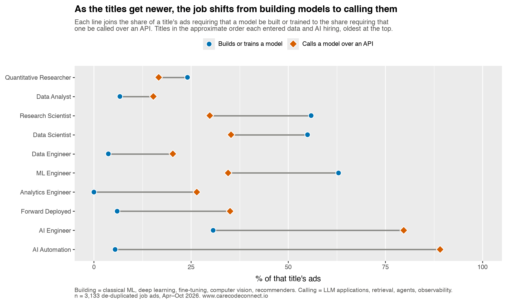{fig-alt="Grouped bar chart of the job titles showing the share of each title's ads that require building or training a model versus calling one over an API"}

Each of the 10 titles is below, in broadly chronological order — approximately when each title began appearing in data and AI hiring, oldest first. **The dates are background, not measured**: this sample runs  and can say nothing about when a title appeared. Everything inside each title is measured from the ads. Open a title to see what its ads require, the phrases they use, and its nearest neighbours on the skills map.

::: {.callout-note collapse="true" appearance="simple"}
### 1. Quantitative Researcher {#sec-title-quantitative-researcher .unnumbered}

*finance, 1980s–1990s · 54 ads, 2% of the sample*

The oldest title here, and the one that got there first. Investment banks and hedge funds were hiring mathematicians and physicists to price derivatives and find trading signals two decades before anyone said “data scientist”. Everything the later titles claim as novel — statistics on large datasets, models in production, money riding on the output — was already the job.

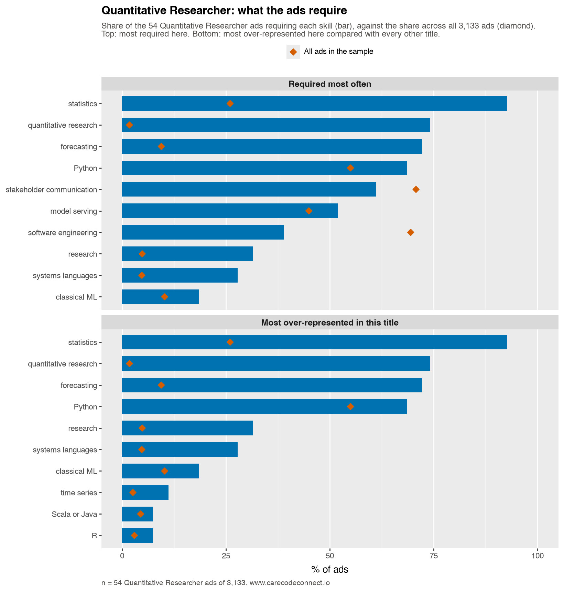{fig-alt="Bar chart of the skills Quantitative Researcher ads require most often and the skills most over-represented in them, each against the share across all ads"}

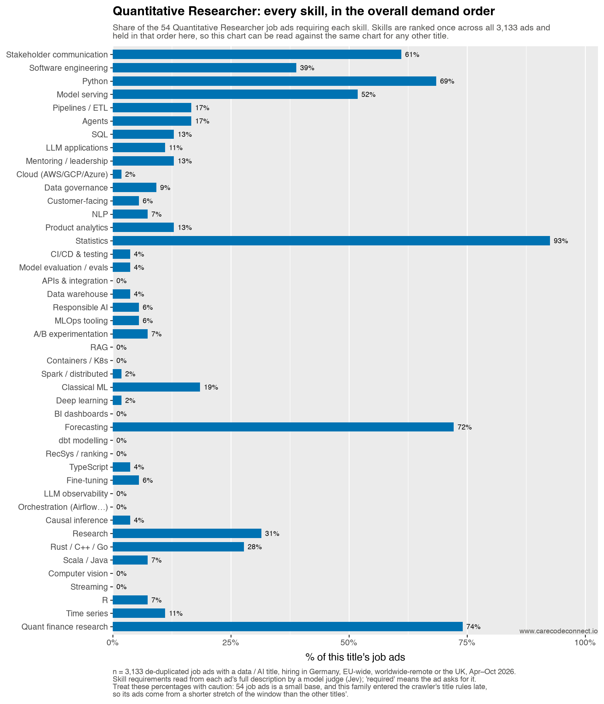{fig-alt="Bar chart of every tracked skill for Quantitative Researcher ads, in the overall demand order, so it can be read against the same chart for any other title"}

**Read these percentages with caution.** 54 job ads is a small base: a single ad moves any figure here by about 2 points. It is a rare title in this pool rather than a late-admitted one, so the base is small but the window is the same as every other title's.

**Take-home.** 19% of these ads want both a model and its deployment and 15% a model without it; the most distinctive requirement is quantitative research, and the nearest title is Data Scientist.

**Nearest neighbour.** Data Scientist (1.33 apart on the skills map), then Research Scientist (1.45). Furthest: Analytics Engineer (2.39).

**Build or call.** 24% build or train a model, 17% call one over an API, and 9% want the API work with no model-building at all.

**In the ads' own words.** The phrases most over-represented in this title, read out of the ads by a second model that was never shown our skill list, with the share of the title's ads using each: “portfolio construction” (7%), “derivatives pricing” (6%), “high-frequency trading” (6%), “large dataset analysis” (9%), “quantitative modeling” (11%).

> 5+ years of experience with quantitative modeling and pricing
>
> <small>— one of **6** Quantitative Researcher job ads (11% of the title) that ask for “quantitative modeling”</small>

> Strong understanding of market mechanics and microstructure invariants
>
> <small>— one of **5** Quantitative Researcher job ads (9% of the title) that ask for “market microstructure”</small>

:::

::: {.callout-note collapse="true" appearance="simple"}
### 2. Data Analyst {#sec-title-data-analyst .unnumbered}

*business intelligence, 1990s–2000s · 314 ads, 10% of the sample*

Grew out of business intelligence and reporting. The job was to turn a company’s own operational data into numbers a manager could act on, and the tooling was the warehouse and the dashboard rather than the notebook.

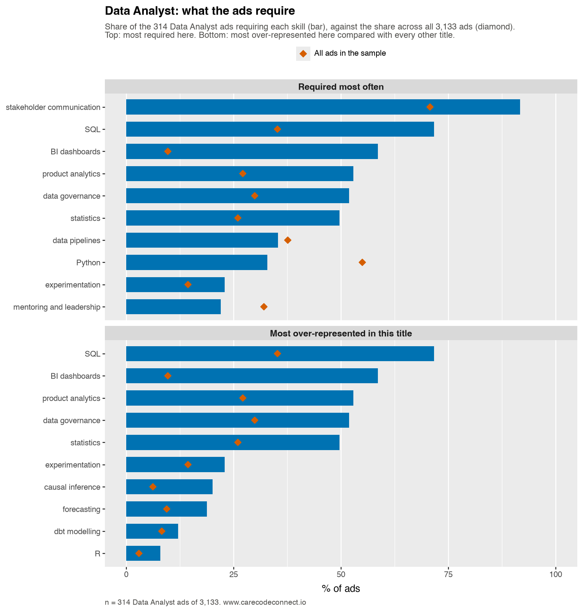{fig-alt="Bar chart of the skills Data Analyst ads require most often and the skills most over-represented in them, each against the share across all ads"}

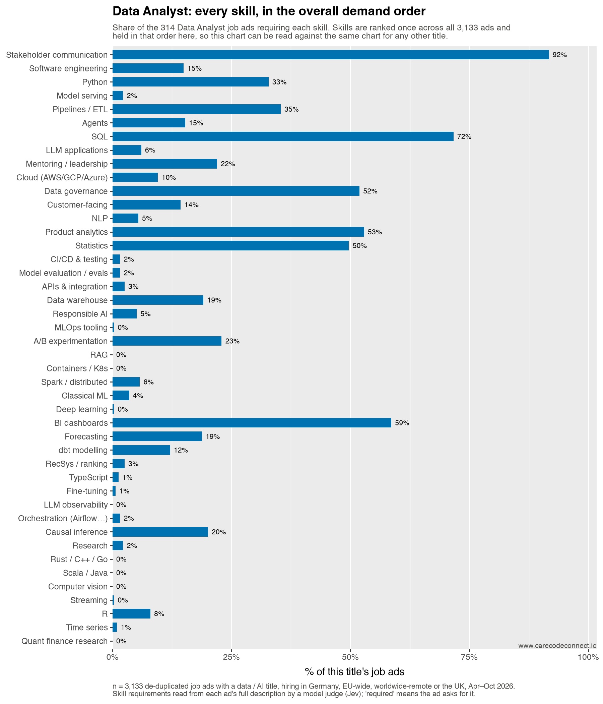{fig-alt="Bar chart of every tracked skill for Data Analyst ads, in the overall demand order, so it can be read against the same chart for any other title"}

**Take-home.** 4% of these ads want both a model and its deployment and 14% a model without it; the most distinctive requirement is BI dashboards, and the nearest title is Data Scientist.

**Nearest neighbour.** Data Scientist (1.29 apart on the skills map), then Analytics Engineer (1.47). Furthest: AI Engineer (2.09).

**Build or call.** 7% build or train a model, 15% call one over an API, and 14% want the API work with no model-building at all.

**In the ads' own words.** The phrases most over-represented in this title, read out of the ads by a second model that was never shown our skill list, with the share of the title's ads using each: “dashboard design” (8%), “excel” (20%), “cohort analysis” (5%), “tableau” (31%), “power bi” (34%).

> data visualisation tools such as Power BI
>
> <small>— one of **107** Data Analyst job ads (34% of the title) that ask for “power bi”</small>

> A/B testing that directly influence product improvements
>
> <small>— one of **58** Data Analyst job ads (18% of the title) that ask for “a/b testing”</small>

:::

::: {.callout-note collapse="true" appearance="simple"}
### 3. Research Scientist {#sec-title-research-scientist .unnumbered}

*industrial labs, long-standing; current AI form from ~2012 · 161 ads, 5% of the sample*

The title is far older than data science — industrial research labs have used it for most of a century — but the version that shows up in this sample is the deep-learning lab role that followed the 2012 ImageNet result: publish, train large models, push the state of the art.

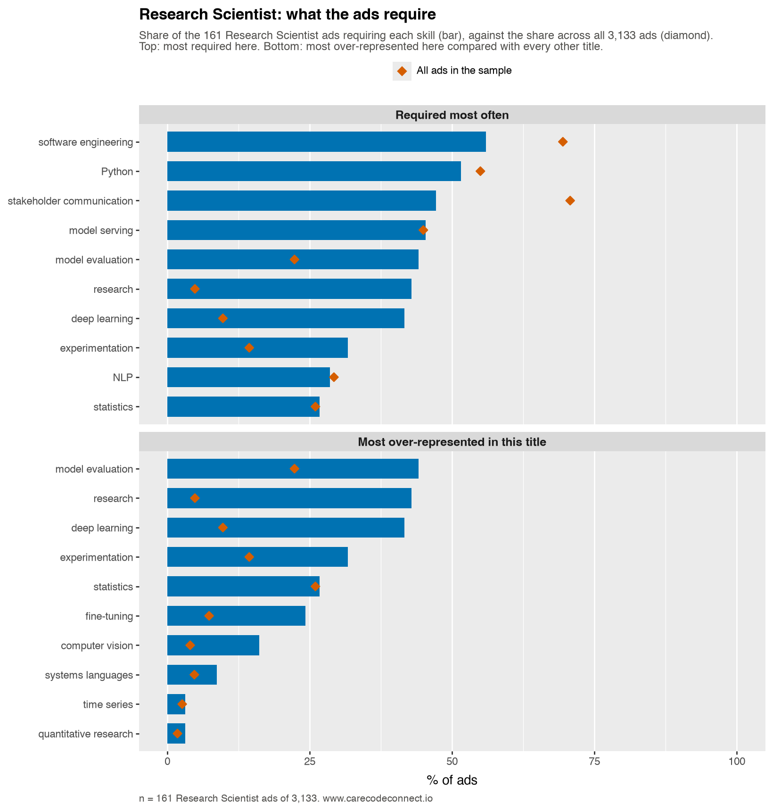{fig-alt="Bar chart of the skills Research Scientist ads require most often and the skills most over-represented in them, each against the share across all ads"}

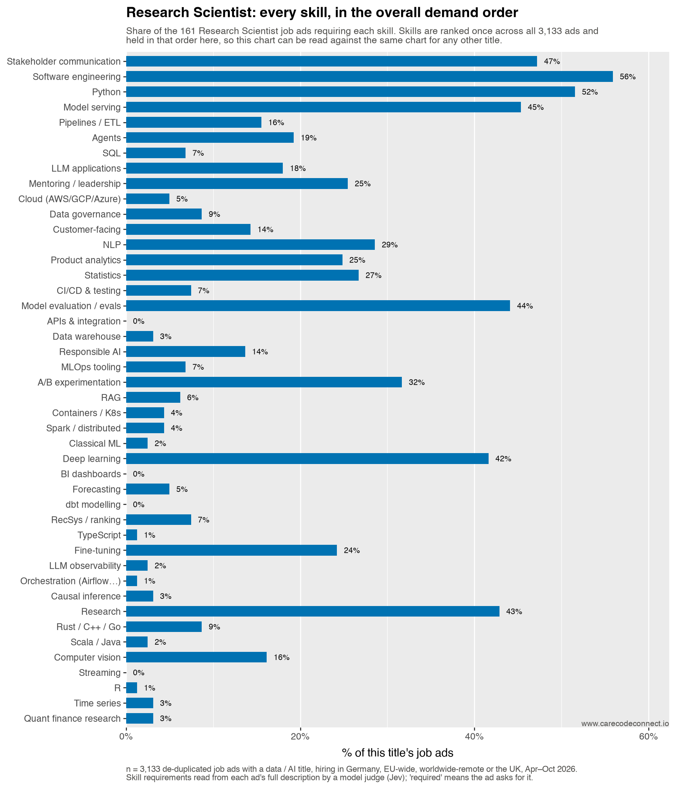{fig-alt="Bar chart of every tracked skill for Research Scientist ads, in the overall demand order, so it can be read against the same chart for any other title"}

**Take-home.** 39% of these ads want both a model and its deployment and 24% a model without it; the most distinctive requirement is research, and the nearest title is ML Engineer.

**Nearest neighbour.** ML Engineer (1.02 apart on the skills map), then Data Scientist (1.18). Furthest: Analytics Engineer (2.08).

**Build or call.** 56% build or train a model, 30% call one over an API, and 9% want the API work with no model-building at all.

**In the ads' own words.** The phrases most over-represented in this title, read out of the ads by a second model that was never shown our skill list, with the share of the title's ads using each: “sglang” (6%), “jax” (13%), “experimental design” (12%), “reinforcement learning” (17%), “cuda” (11%).

> Strong empirical research skills in Reinforcement Learning
>
> <small>— one of **28** Research Scientist job ads (17% of the title) that ask for “reinforcement learning”</small>

> state-of-the-art Deep Learning and Reinforcement Learning models
>
> <small>— one of **28** Research Scientist job ads (17% of the title) that ask for “deep learning”</small>

:::

::: {.callout-note collapse="true" appearance="simple"}
### 4. Data Scientist {#sec-title-data-scientist .unnumbered}

*coined 2008, mainstream from ~2012 · 513 ads, 16% of the sample*

Coined in 2008 by D.J. Patil and Jeff Hammerbacher, then leading data at LinkedIn and Facebook, and made famous by the 2012 *[Harvard Business Review](https://hbr.org/2012/10/data-scientist-the-sexiest-job-of-the-21st-century)* piece. The pitch was a hybrid: enough statistics to be rigorous, enough code to be self-sufficient, enough business sense to be listened to.

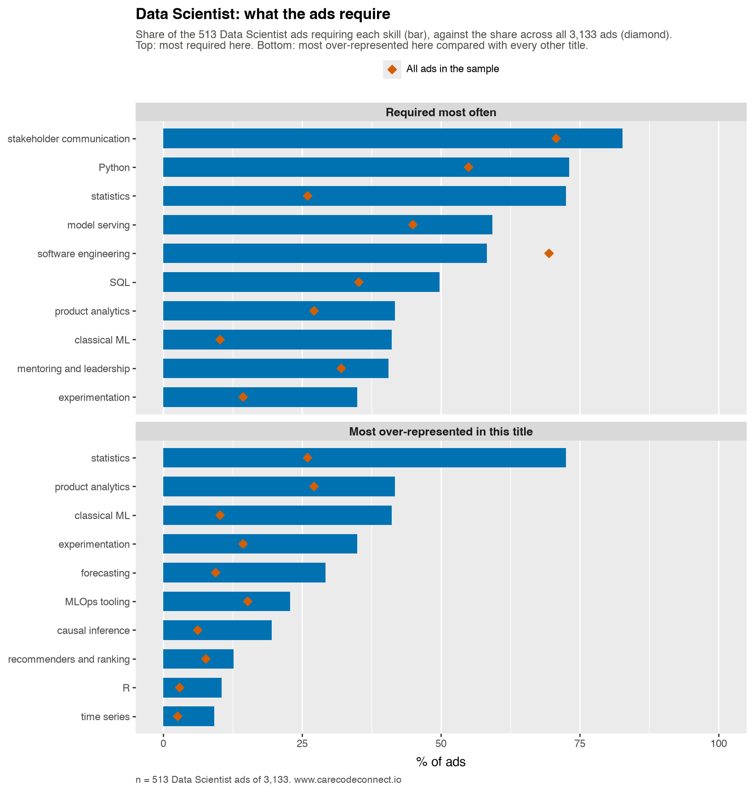{fig-alt="Bar chart of the skills Data Scientist ads require most often and the skills most over-represented in them, each against the share across all ads"}

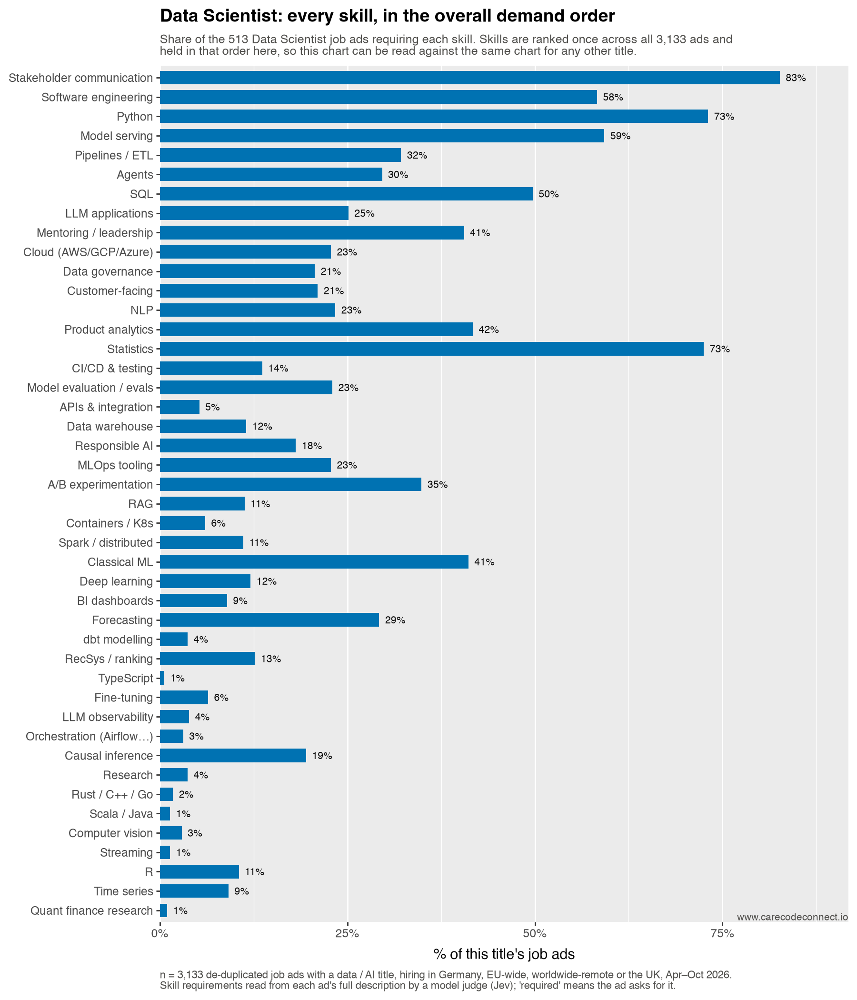{fig-alt="Bar chart of every tracked skill for Data Scientist ads, in the overall demand order, so it can be read against the same chart for any other title"}

**Take-home.** 49% of these ads want both a model and its deployment and 16% a model without it; the most distinctive requirement is classical ML, and the nearest title is ML Engineer.

**Nearest neighbour.** ML Engineer (1.11 apart on the skills map), then Research Scientist (1.18). Furthest: Analytics Engineer (1.85).

**Build or call.** 55% build or train a model, 35% call one over an API, and 12% want the API work with no model-building at all.

**In the ads' own words.** The phrases most over-represented in this title, read out of the ads by a second model that was never shown our skill list, with the share of the title's ads using each: “regression” (6%), “statistical modeling” (9%), “data science” (29%), “clustering” (6%), “classification” (6%).

> experimental design, causal inference and quasi-experimental methods
>
> <small>— one of **69** Data Scientist job ads (13% of the title) that ask for “causal inference”</small>

> Expertise in machine learning and predictive modelling
>
> <small>— one of **39** Data Scientist job ads (8% of the title) that ask for “predictive modeling”</small>

:::

::: {.callout-note collapse="true" appearance="simple"}
### 5. Data Engineer {#sec-title-data-engineer .unnumbered}

*~2011–2014 · 458 ads, 15% of the sample*

Split off from the data scientist once companies discovered that most of the work was moving and shaping data rather than modelling it. Hadoop, then Spark, then the cloud warehouse made the pipeline a full-time job.

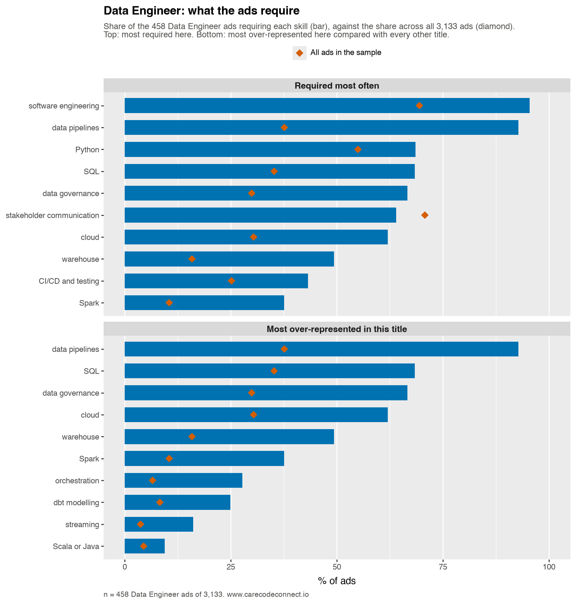{fig-alt="Bar chart of the skills Data Engineer ads require most often and the skills most over-represented in them, each against the share across all ads"}

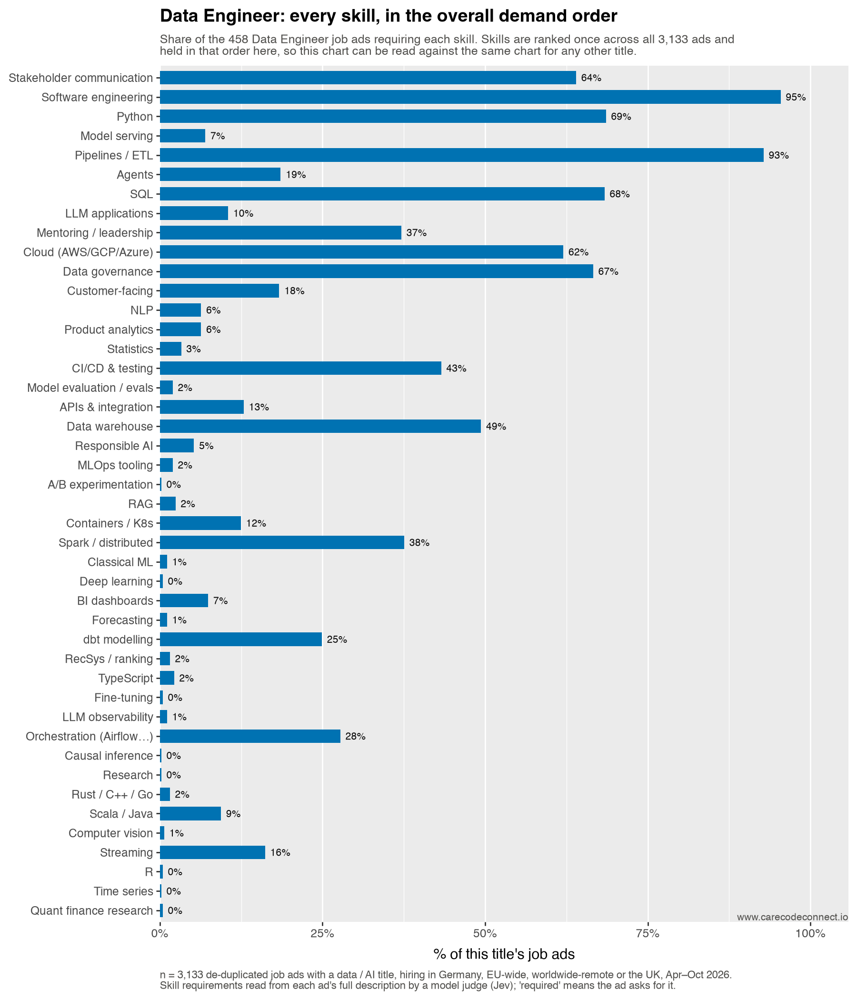{fig-alt="Bar chart of every tracked skill for Data Engineer ads, in the overall demand order, so it can be read against the same chart for any other title"}

**Take-home.** 19% of these ads want both a model and its deployment and 3% a model without it; the most distinctive requirement is orchestration, and the nearest title is Analytics Engineer.

**Nearest neighbour.** Analytics Engineer (0.95 apart on the skills map), then Data Analyst (1.69). Furthest: Quantitative Researcher (2.22).

**Build or call.** 4% build or train a model, 20% call one over an API, and 19% want the API work with no model-building at all.

**In the ads' own words.** The phrases most over-represented in this title, read out of the ads by a second model that was never shown our skill list, with the share of the title's ads using each: “etl/elt” (10%), “apache airflow” (6%), “delta lake” (6%), “azure data factory” (6%), “data security” (7%).

> Own the design of scalable ETL/ELT pipelines
>
> <small>— one of **44** Data Engineer job ads (10% of the title) that ask for “etl/elt”</small>

:::

::: {.callout-note collapse="true" appearance="simple"}
### 6. ML Engineer {#sec-title-ml-engineer .unnumbered}

*~2015–2016 · 278 ads, 9% of the sample*

Split off from the other side of the data scientist: the half concerned with getting a trained model to run reliably for real users. The title tracks the arrival of model serving, feature stores and the tooling that became MLOps.

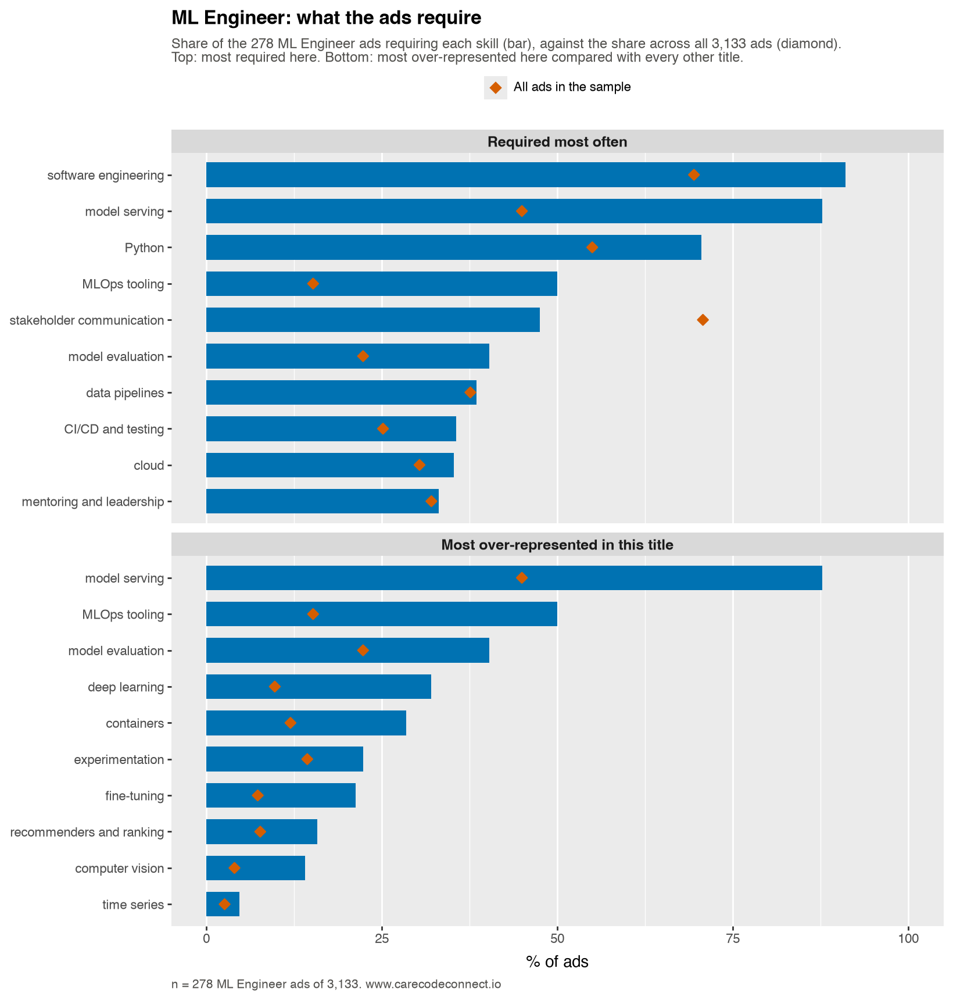{fig-alt="Bar chart of the skills ML Engineer ads require most often and the skills most over-represented in them, each against the share across all ads"}

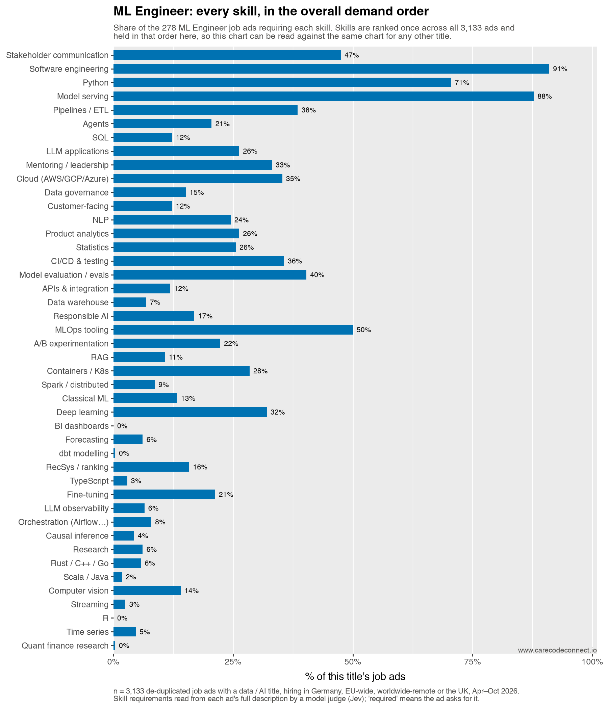{fig-alt="Bar chart of every tracked skill for ML Engineer ads, in the overall demand order, so it can be read against the same chart for any other title"}

**Take-home.** 63% of these ads want both a model and its deployment and 5% a model without it; the most distinctive requirement is MLOps tooling, and the nearest title is Research Scientist.

**Nearest neighbour.** Research Scientist (1.02 apart on the skills map), then AI Engineer (1.06). Furthest: Analytics Engineer (2.02).

**Build or call.** 63% build or train a model, 35% call one over an API, and 8% want the API work with no model-building at all.

**In the ads' own words.** The phrases most over-represented in this title, read out of the ads by a second model that was never shown our skill list, with the share of the title's ads using each: “ml pipelines” (5%), “model serving” (14%), “kubeflow” (7%), “feature stores” (5%), “diffusion models” (5%).

> training and iterating on deep learning models
>
> <small>— one of **25** ML Engineer job ads (9% of the title) that ask for “model training”</small>

> transition of machine learning models into production
>
> <small>— one of **49** ML Engineer job ads (18% of the title) that ask for “model deployment”</small>

:::

::: {.callout-note collapse="true" appearance="simple"}
### 7. Analytics Engineer {#sec-title-analytics-engineer .unnumbered}

*~2018–2019 · 102 ads, 3% of the sample*

The newest of the analytics titles, and essentially a dbt-era invention: apply software engineering practice — version control, tests, modular transformations — to the modelling layer between the warehouse and the dashboard.

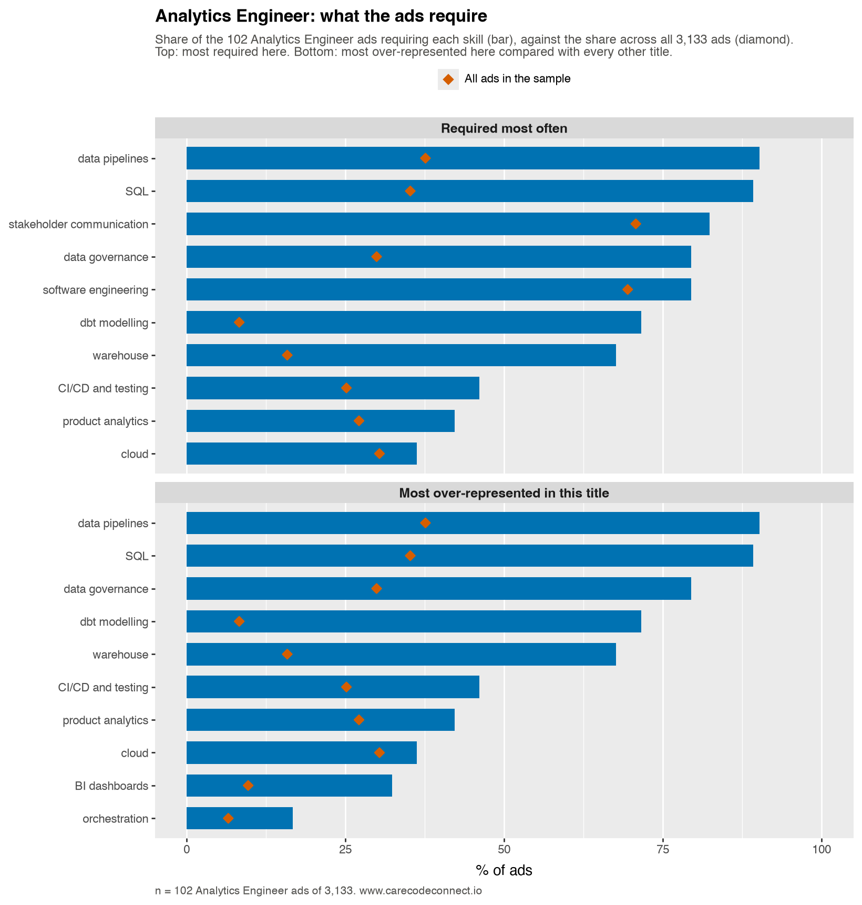{fig-alt="Bar chart of the skills Analytics Engineer ads require most often and the skills most over-represented in them, each against the share across all ads"}

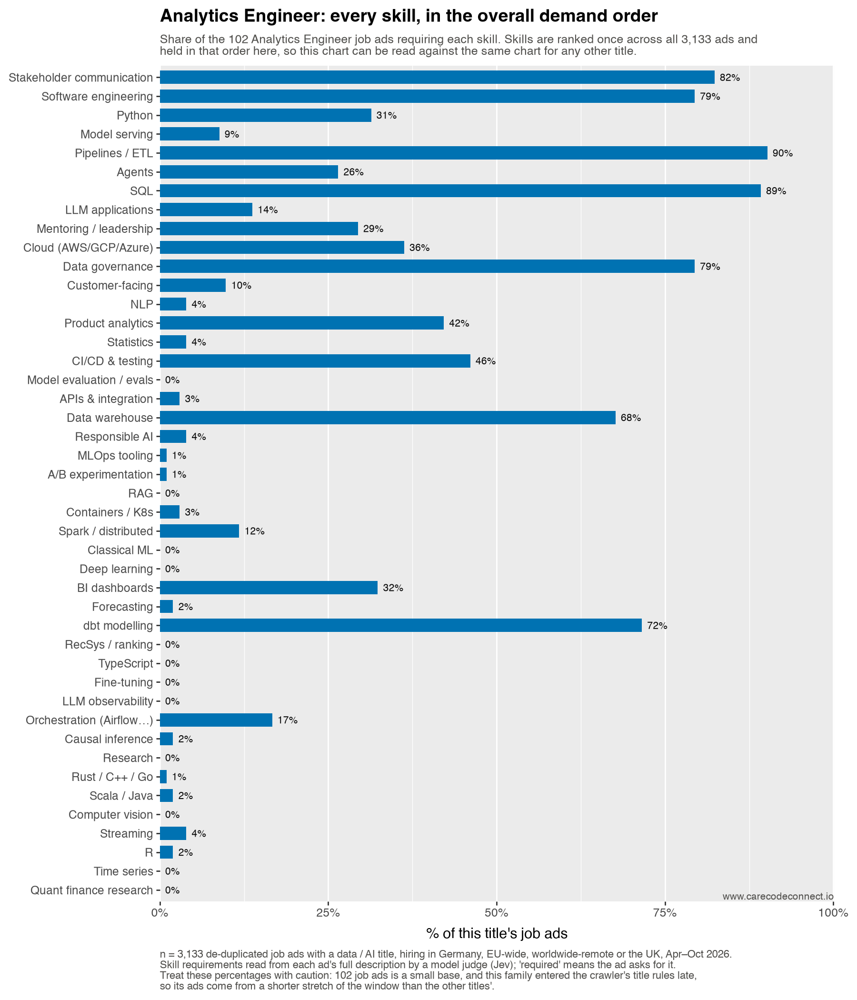{fig-alt="Bar chart of every tracked skill for Analytics Engineer ads, in the overall demand order, so it can be read against the same chart for any other title"}

**Read these percentages with caution.** 102 job ads is a small base: a single ad moves any figure here by about 1 point. It is a rare title in this pool rather than a late-admitted one, so the base is small but the window is the same as every other title's.

**Take-home.** 21% of these ads want both a model and its deployment and 6% a model without it; the most distinctive requirement is dbt modelling, and the nearest title is Data Engineer.

**Nearest neighbour.** Data Engineer (0.95 apart on the skills map), then Data Analyst (1.47). Furthest: Quantitative Researcher (2.39).

**Build or call.** 0% build or train a model, 26% call one over an API, and 26% want the API work with no model-building at all.

**In the ads' own words.** The phrases most over-represented in this title, read out of the ads by a second model that was never shown our skill list, with the share of the title's ads using each: “semantic layer” (6%), “analytics engineering” (20%), “dimensional modeling” (13%), “data quality testing” (6%), “semantic layers” (6%).

> modeled in dbt and orchestrated by Airflow
>
> <small>— one of **61** Analytics Engineer job ads (60% of the title) that ask for “dbt”</small>

:::

::: {.callout-note collapse="true" appearance="simple"}
### 8. Forward Deployed {#sec-title-forward-deployed .unnumbered}

*Palantir-era term, mainstream from ~2023 · 468 ads, 15% of the sample*

A solutions-engineering lineage with a newer name. The engineer is embedded with the customer, building and adapting the product in front of them. The term escaped Palantir and spread as AI vendors discovered their product needed fitting to each buyer.

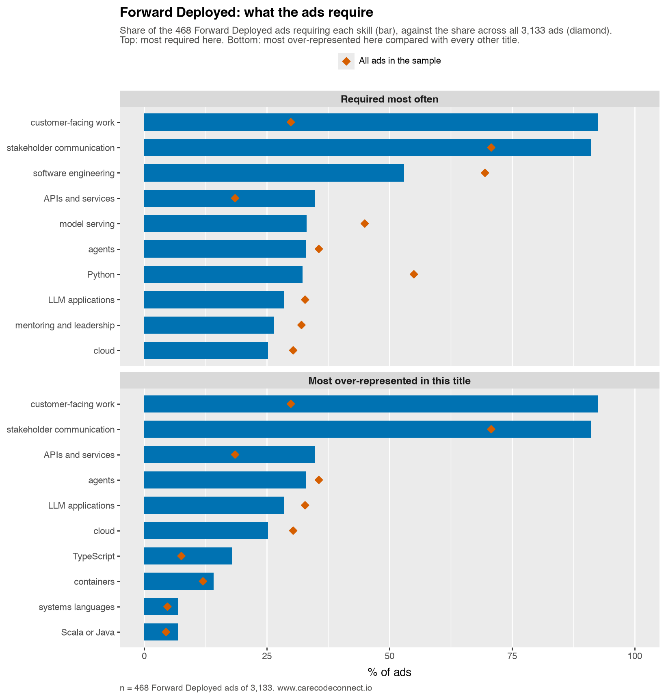{fig-alt="Bar chart of the skills Forward Deployed ads require most often and the skills most over-represented in them, each against the share across all ads"}

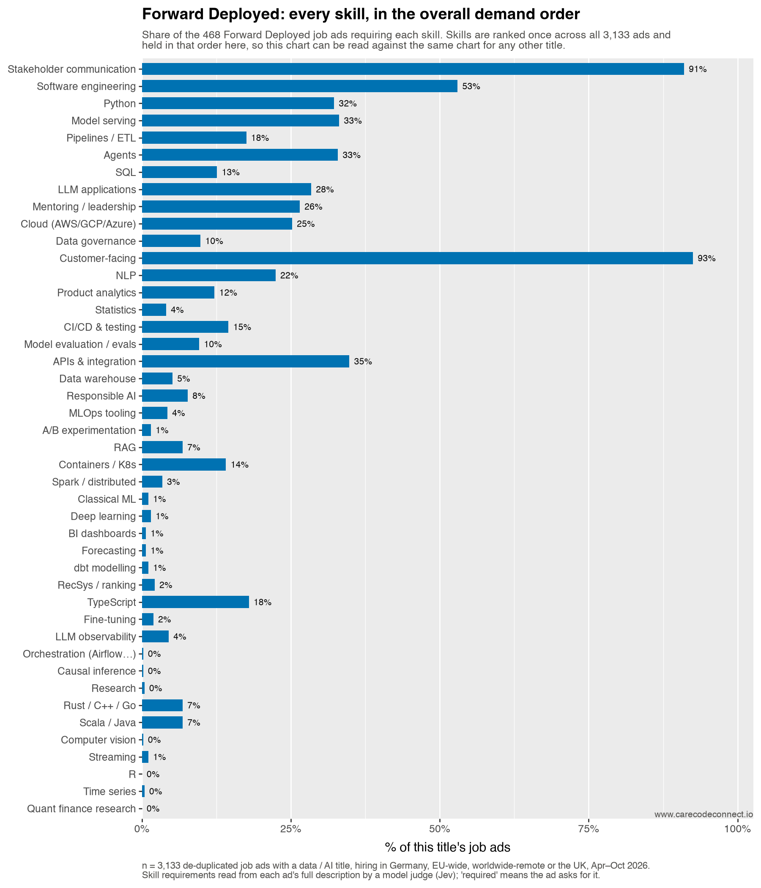{fig-alt="Bar chart of every tracked skill for Forward Deployed ads, in the overall demand order, so it can be read against the same chart for any other title"}

**Take-home.** 29% of these ads want both a model and its deployment and 7% a model without it; the most distinctive requirement is customer-facing work, and the nearest title is AI Automation.

**Nearest neighbour.** AI Automation (1.22 apart on the skills map), then Research Scientist (1.34). Furthest: Analytics Engineer (1.97).

**Build or call.** 6% build or train a model, 35% call one over an API, and 31% want the API work with no model-building at all.

**In the ads' own words.** The phrases most over-represented in this title, read out of the ads by a second model that was never shown our skill list, with the share of the title's ads using each: “solutions engineering” (12%), “solution architecture” (9%), “customer communication” (7%), “solution design” (5%), “customer engagement” (5%).

> 8+ years experience in Solution Engineering role
>
> <small>— one of **57** Forward Deployed job ads (12% of the title) that ask for “solutions engineering”</small>

:::

::: {.callout-note collapse="true" appearance="simple"}
### 9. AI Engineer {#sec-title-ai-engineer .unnumbered}

*~2023 · 730 ads, 23% of the sample*

The newest title in the sample and already the largest. It arrived with the production LLM stack — applications, retrieval, agents, evaluation — and it is the one title here defined by what it builds *with* rather than what it knows.

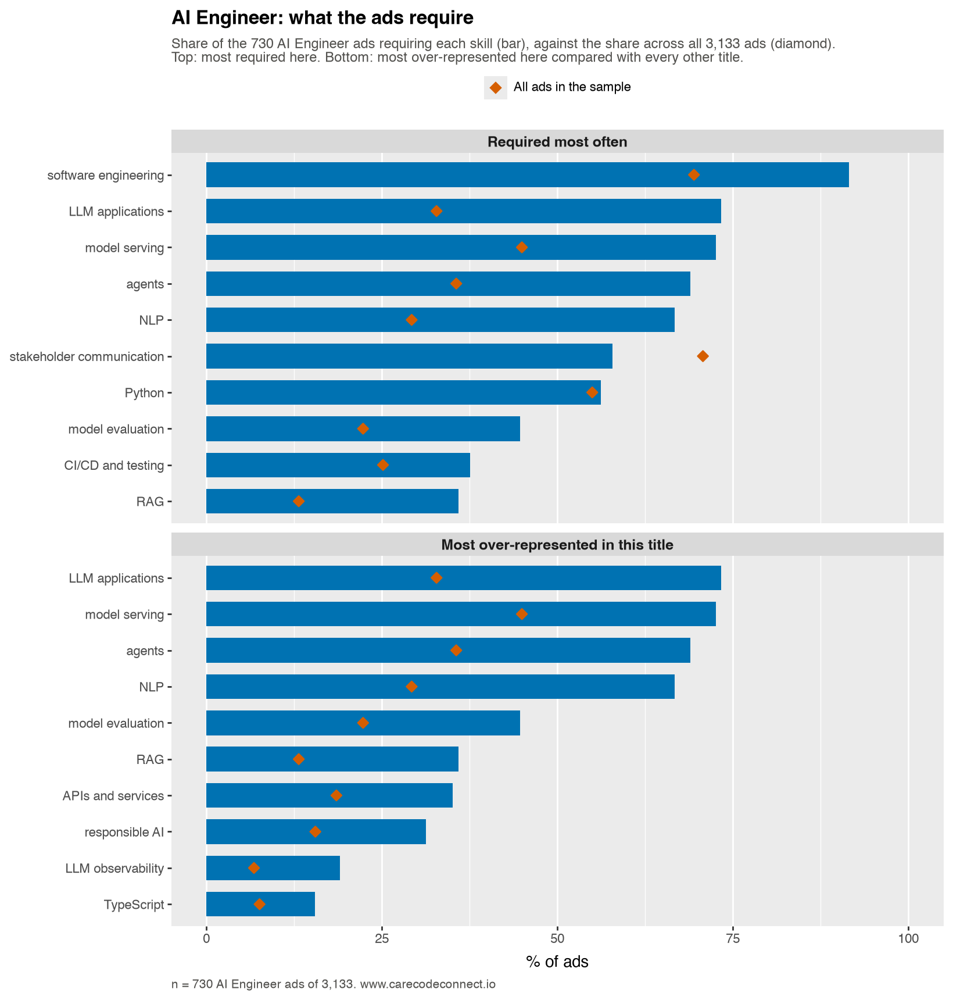{fig-alt="Bar chart of the skills AI Engineer ads require most often and the skills most over-represented in them, each against the share across all ads"}

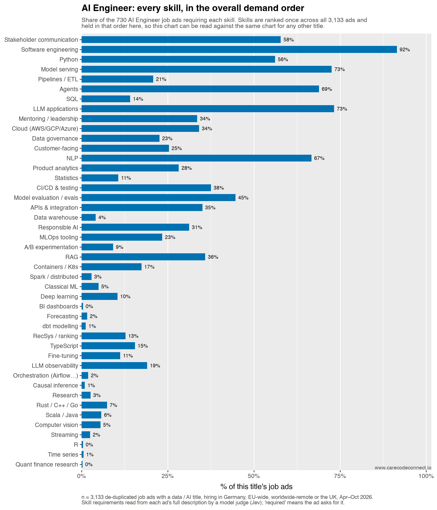{fig-alt="Bar chart of every tracked skill for AI Engineer ads, in the overall demand order, so it can be read against the same chart for any other title"}

**Take-home.** 74% of these ads want both a model and its deployment and 12% a model without it; the most distinctive requirement is RAG, and the nearest title is AI Automation.

**Nearest neighbour.** AI Automation (0.75 apart on the skills map), then ML Engineer (1.06). Furthest: Analytics Engineer (2.15).

**Build or call.** 31% build or train a model, 80% call one over an API, and 55% want the API work with no model-building at all.

**In the ads' own words.** The phrases most over-represented in this title, read out of the ads by a second model that was never shown our skill list, with the share of the title's ads using each: “langgraph” (14%), “tool use” (7%), “vector search” (5%), “rag” (22%), “prompt engineering” (23%).

> using large language models, RAG, vector search
>
> <small>— one of **163** AI Engineer job ads (22% of the title) that ask for “rag”</small>

> AI application patterns (RAG, agents, tool use)
>
> <small>— one of **13** AI Engineer job ads (2% of the title) that ask for “agents”</small>

> Exposure to fine-tuning or continuous learning techniques
>
> <small>— one of **41** AI Engineer job ads (6% of the title) that ask for “fine-tuning”</small>

:::

::: {.callout-note collapse="true" appearance="simple"}
### 10. AI Automation {#sec-title-ai-automation .unnumbered}

*~2024 · 55 ads, 2% of the sample*

The newest family here, and the one the crawler began tracking last. The titles are AI, agentic, intelligent or workflow automation — Engineer, Specialist, Lead or Consultant — and they describe wiring an LLM into a business process rather than building a model. The QA, industrial and robotic-process senses of the word are excluded; they are a different job. **Read its share as a floor, not a measurement:** the crawler only began admitting these titles in the final week of this window, and only began searching sources for them the day after, so earlier months caught them only incidentally, through other search terms.

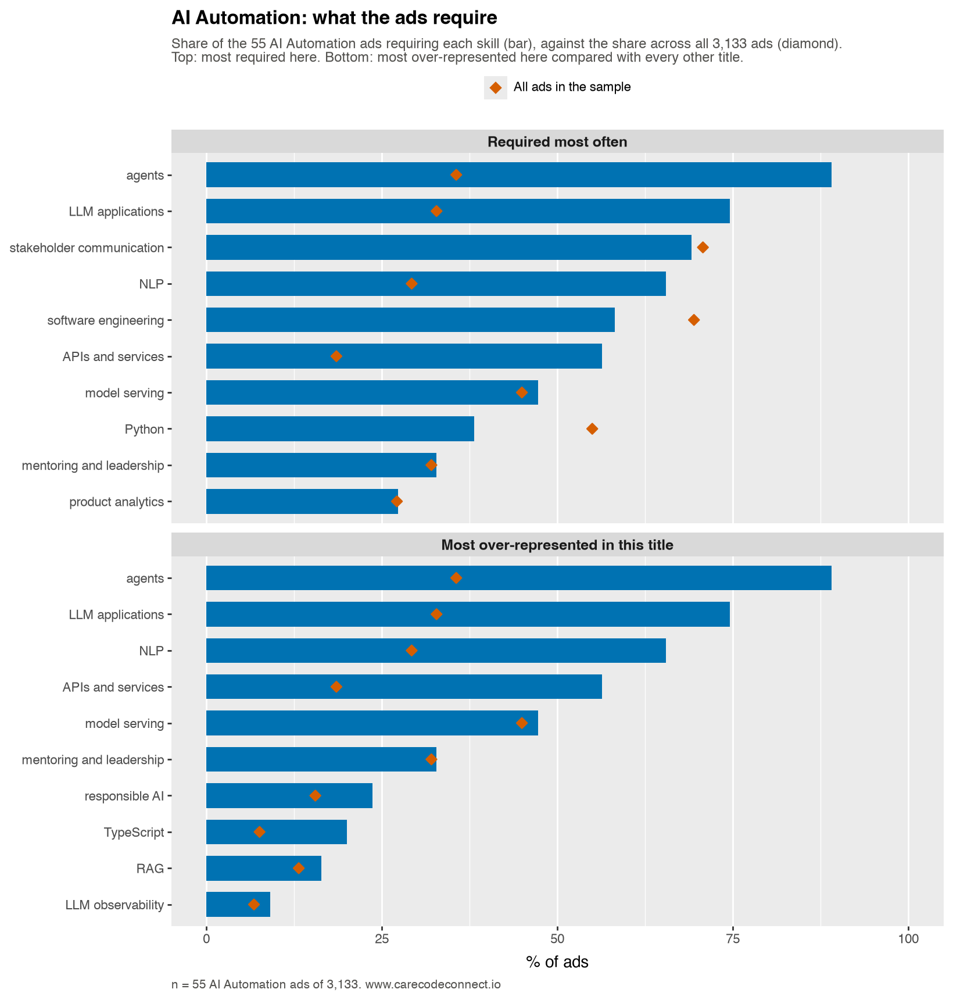{fig-alt="Bar chart of the skills AI Automation ads require most often and the skills most over-represented in them, each against the share across all ads"}

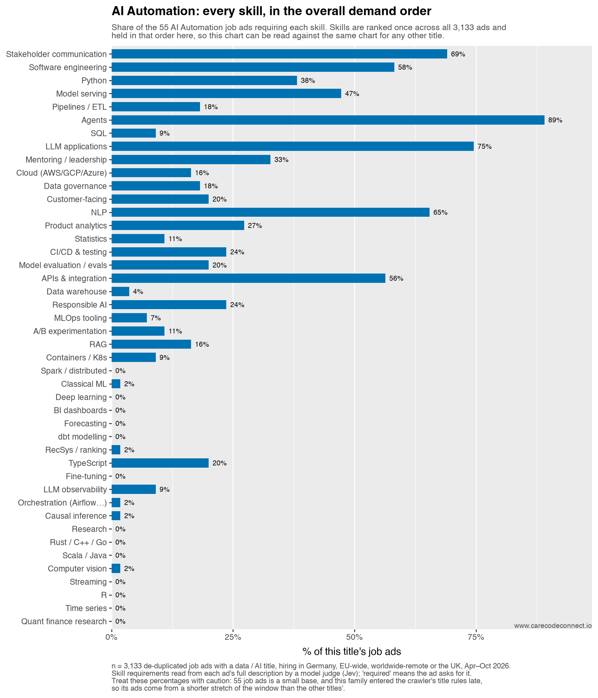{fig-alt="Bar chart of every tracked skill for AI Automation ads, in the overall demand order, so it can be read against the same chart for any other title"}

**Read these percentages with caution.** 55 job ads is a small base: a single ad moves any figure here by about 2 points. On top of that it entered the crawler's title rules late — 53% of its ads fall in the final month against 35% for the sample — so a difference against another title here may be when the ads were collected rather than what the title asks for.

**Take-home.** 62% of these ads want both a model and its deployment and 27% a model without it; the most distinctive requirement is APIs and services, and the nearest title is AI Engineer.

**Nearest neighbour.** AI Engineer (0.75 apart on the skills map), then Forward Deployed (1.22). Furthest: Analytics Engineer (2.13).

**Build or call.** 5% build or train a model, 89% call one over an API, and 84% want the API work with no model-building at all.

**In the ads' own words.** The phrases most over-represented in this title, read out of the ads by a second model that was never shown our skill list, with the share of the title's ads using each: “microsoft copilot” (9%), “make” (16%), “zendesk” (7%), “zapier” (16%), “power apps” (7%).

:::

