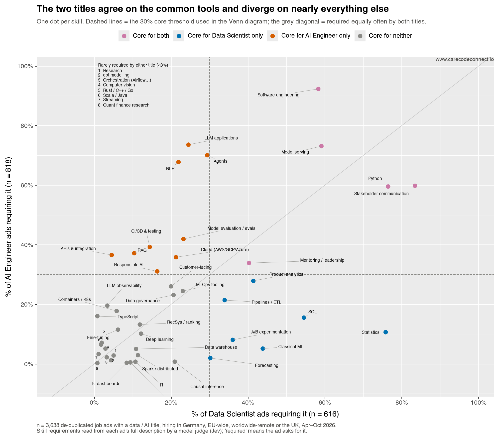

## Executive summary

Is "AI Engineer" the new name for "Data Scientist", or a different job?  job ads, each scored against a fixed vocabulary of  skills.

- **AI and data work has spread beyond the Data Scientist title.** Clustering the skills by what employers ask for together splits the market into three groups, and each region of that split is dominated by a different title. The centre — ads wanting all three — is % of ads, and % of it carries a title other than Data Scientist.
- "AI Engineer" is the most frequent title at %, ahead of "Data Scientist" (%) and "Data Engineer" (%).
- Stakeholder communication is the most-required skill at %, ahead of Python at %. % of AI Engineer ads do not require Python.
- Statistics is required in % of Data Scientist ads and % of AI Engineer ads.
- The two titles are  apart on their requirement profiles, further apart than Data Scientist and Data Analyst ().
- ML Engineer sits  from Data Scientist and  from AI Engineer, the shortest link between the two.
- Data Scientist, AI Engineer and ML Engineer share  required skills: .
- Data Engineer and Analytics Engineer are  apart, the shortest distance on the map. Data governance is required in % and % of their ads, against % elsewhere.
- % of ads fall in Conway's "danger zone" — code and domain, no statistics.
- LLM and agent engineering is new since "Data Scientist" was popularised:  of the tracked skills fit none of Conway's 2010 circles. % of ads require at least one — % of AI Engineer ads but % of Data Scientist ads, so the new skillset has not been absorbed into the older title.

## The question: is AI Engineer the new Data Scientist?

In September 2010 Drew Conway drew three overlapping circles — hacking skills, maths and statistics, substantive expertise — with data science in the middle and **"danger zone!"** where code met domain knowledge without statistics. He meant the warning: people who can pull data and run a regression without knowing what the coefficients mean.

Sixteen years on, employers advertise for "AI Engineer" more often than for "Data Scientist". Conway's is the only one of the field's canonical pictures that can be tested against a job ad — it says what a data scientist must *know*, and knowledge is what ads ask for. So: do his circles still describe what is being hired, and are the two titles one job or two?

## How this was measured: one fixed question per skill, every ad

::: {.callout-note collapse="true" appearance="simple"}
## Which ads, and where they came from {.unnumbered}

- ** job ads**, de-duplicated, with a data / AI title: AI Engineer , Data Scientist , Data Engineer , Forward Deployed , Data Analyst , ML Engineer , Research Scientist , Analytics Engineer , Quantitative Researcher .
- **Where they hire:** Germany, EU-wide remote, worldwide remote, or the UK. Live .
- **Where they come from:** employers' own boards and careers pages, aggregators, and a curated feed. The published data carries no source or employer, and the same opening reached by two routes counts once (matched on URL and on company + title).
- **Titles come from the ad**, by regular expression over the job title; "AI Engineer" includes variants such as "Senior Software Engineer – AI".
- **Not a random sample.** These are the ads a personal crawler targets, so they describe what the titles ask for, not how many of each exist.
:::

::: {.callout-note collapse="true" appearance="simple"}
## How the skills were scored {.unnumbered}

Scores come from the production pipeline of **jobcrawler**, a personal job-board crawler that scrapes employer ATS boards, filters by title and location with deterministic rules, and stores each ad. After storage every ad is read once by **Jev** (TypeSafe's System One model, version ), which answers typed questions and returns probabilities rather than text.

- For each of ** tracked skills** Jev answers one four-level question: does the ad *not involve* the skill, *mention it in passing*, list it as *nice to have*, or *require* it. One question per skill, so an answer cannot contradict itself, and the same question is answered for every ad — which is the only reason the percentages compare across titles.
- An ad requires the skill when "required" reaches probability . Most judgements come back "not involved"; roughly one in six reaches "required".
- Jev has no part in choosing the ads: the pool is gathered and filtered by rules.
- Cost: about 6k input tokens per ad, under a cent.

The scores are model judgements, consistent across titles but never checked against human labels: read the percentages as what a careful reader of the ad would conclude, with a few points of noise. **"Required" is a high bar** — every percentage counts ads where the skill reaches *required*, not ads that mention it. Across all ads, % mention machine learning on Jev's reading and % on a second model's, against % requiring it. Agreement on the required call is moderate (Cohen's κ ≈ ), so treat a single figure as approximate and the direction as solid.
:::

::: {.callout-note collapse="true" appearance="simple"}
## Where the skill list comes from, and how it grows {.unnumbered}

The  skills are a *fixed vocabulary*, not everything an ad might mention. A free-for-all count of whatever words appear cannot compare titles, because no two employers use the same words.

The list is curated but not frozen, and **two passes read every ad**. Pass one is Jev, above. Pass two is an open-vocabulary extraction: a small, cheap model (Claude Haiku) reads each ad with one instruction — list every skill, tool or method it asks for, **in the ad's own words**, say whether it is required or nice to have, and quote the sentence showing it. Nothing is matched against the vocabulary at this stage; the model does not know it exists.

That covers the whole pool: ** mentions** across ** distinct phrases**,  of them in ten ads or more. An alias table maps a phrase onto a vocabulary skill where the mapping is obvious — "PostgreSQL" to SQL, "Kubernetes" to containers, "RLHF" to deep learning — and % of mentions map. **The rest are the point**: what ads keep asking for that the vocabulary has no question for, ranked by how many jobs require it.

A weekly review reads that ranking and proposes additions; a human accepts or rejects, because adding a skill re-scores every ad. The review of  accepted four — **software engineering** ( jobs), **data governance** (), **APIs and integration** () and **responsible AI** () — and rejected three: "problem-solving" ( jobs) and English and German ( between them) are traits and languages rather than skills, and "data science" () is the name of the field.

Adding "software engineering" overturned one of this page's own findings: before it was tracked, Data Scientist and AI Engineer appeared to share no core skill at all. Every figure regenerates whenever the vocabulary moves (vocabulary as of ).
:::

::: {.callout-warning collapse="true" appearance="simple"}
## One known limitation: is machine learning simply assumed? {.unnumbered}

Partly. Of  Data Scientist ads,  never write machine learning, deep learning or neural network — but % of those name a technique or tool that unmistakably is one. Correcting for that raises the figure from % to about %, meeting the independent estimate from the other direction (% detected at some level).

The remaining  ads (% of Data Scientist ads) name neither the concept nor any of its tools, asking instead for Python, SQL, A/B testing, causal inference, R, dbt, Tableau and stakeholder communication.
:::

::: {.callout-note collapse="true" appearance="simple"}
## The data, the charts, and permissions {.unnumbered}

The underlying data is published with this page: [**download it here**](data/ai-data-job-skills.csv), with a [**companion list of the skills**](data/skills.json) and their areas. One row per ad — title, title family, hiring region, month, position on the map, and a yes/no flag for each of the  skills. Deliberately absent: employer names, links, and any ad text. Enough to redraw every chart and check any number, without republishing anyone's postings.

Charts use [plotnine](https://plotnine.org) for the static figures and [Plotly](https://plotly.com/python/), styled to match, for the interactive map. Colours come from the Okabe-Ito colour-blind-safe palette, and wherever more than three categories share a plot, marker shape carries identity as well as colour.

Conway's diagram is reproduced with attribution from [drewconway.com](http://drewconway.com/zia/2013/3/26/the-data-science-venn-diagram) (Drew Conway, *The Data Science Venn Diagram*, 2010). Only the measured figures and the 2026 circles are this page's own.
:::

## What the field said data science was

Three pictures the field has used to define itself. Only the first can be tested against a job ad: it says what a data scientist must *know*, and knowledge is what ads ask for. The other two describe a process, and no ad says "must be able to scrub".

](images/external/conway-data-science-vd.png){fig-alt="Drew Conway's data science Venn diagram: hacking skills, math and statistics knowledge, substantive expertise, with machine learning, danger zone, traditional research and data science in the overlaps"}

 (archived)](images/osemn.png){fig-alt="The OSEMN pipeline: obtain, scrub, explore, model, interpret"}

](images/external/r4ds-data-science-cycle.png){fig-alt="The R for Data Science cycle: import, tidy, then a loop of transform, visualise and model, then communicate, with program surrounding all of it"}

Conway's circles, sized by how many of these ads land in each region:

{fig-alt="Conway's three circles redrawn with region areas proportional to the share of job ads in each"}

% of ads ask for code and domain engagement but no statistics — the region he marked "danger zone" and thought nearly empty, now second only to his centre (%). And  of the tracked skills fit none of his three circles at all; % of ads require at least one.

## What AI / data roles require in 2026

The circles below are not drawn by hand. The  tracked skills were clustered by how often employers ask for them *in the same ad*, and four groups fall out — three that divide the market, and one required almost everywhere.

{fig-alt="Venn diagram of three skill groups found by clustering the job ads: engineering and AI, data platform, statistics and inference, with the share of ads in each region"}

- **Engineering & AI**,  skills, % of ads. Software engineering, APIs, cloud, CI/CD, serving *and* LLM applications, agents, RAG, evals. The clustering puts shipping software and building on LLMs in one group: ads that want an LLM application overwhelmingly want someone who can run it.
- **Data platform**,  skills, % of ads. SQL, dbt, pipelines, warehouse, BI, governance, streaming, Spark, orchestration.
- **Statistics & inference**,  skills, % of ads. Statistics, experimentation, causal inference, forecasting, time series, quant research — and classical ML, deep learning and computer vision, which cluster here rather than with LLM work.
- **Communication**,  skills, % of ads, required across every region. It is the ground the circles stand on, not a circle: something required almost everywhere separates nobody.

Each region of the diagram is dominated by a different job title, and that is the finding:

| Region | Share of ads | Most common title there |
|---|---|---|
| All three | % |  (% of the region) |
| Engineering & AI + data platform | % |  (%) |
| Engineering & AI alone | % |  (%) |
| Engineering & AI + inference | % |  (%) |
| Data platform + inference | % |  (%) |

**AI and data work has spread beyond the Data Scientist title.** The centre — ads requiring all three groups — is % of the market, and % of it carries a title other than Data Scientist. Every other region belongs to someone else: data platform work to Data Engineers, engineering-and-AI without inference to AI Engineers, data-and-inference without engineering to Data Analysts. Note what this does *not* say: the sample is , so it can show how the work is divided now, not when any of it moved.

Three charts below show what the clustering is made of — which titles are being hired, whether ads want a model built or called, and how often each skill is required.

{fig-alt="Bar chart of the nine job-title families as a share of the ads"}

AI Engineer is the most frequent title at %, then Data Scientist (%) and Data Engineer (%). Analytics Engineer (%) and Quantitative Researcher (%) are rarest.

### More ads call a model than build one

% of ads require building or training a model — classical ML, deep learning, fine-tuning, computer vision, recommenders. % require calling one: LLM applications, retrieval, agents, observability. Only % require both. % want the API work with no model-building at all, against % building without ever touching an API. Fine-tuning, the skill between them, is required in %.

{fig-alt="Chart comparing the share of each job title's ads that require building or training a model against the share that require calling one over an API"}

ML Engineer builds in % of its ads, Research Scientist %, Data Scientist %. AI Engineer inverts it: % call an API, % build. Analytics Engineer is the clean case — % build, % call.

Machine learning of any kind is required in % of ads (classical %, deep learning %), the LLM stack in %. % want the LLM stack and require no machine learning, against % the reverse.

Machine learning is not a circle on the redrawn diagram because it divides nothing. Drawn generously it covers % of ads (), of which % already fall inside one of the three circles and % in the dead centre; its own circle would enclose  ads. It runs through all three — % of the engineering circle, % of inference, % of the LLM circle. Where required, it has moved toward engineering: % of ML ads require model serving against % of the rest.

### Communication outranks every technical skill

{fig-alt="Bar chart of every tracked skill by the share of ads requiring them"}

 leads at %, then  (%),  (%),  (%),  (%),  (%) and  (%). The tail is the specialist end: .

## How the titles differ

### They form a chain, and ML Engineer is the hinge

Each title's profile is the share of its ads requiring each skill; an edge is the Euclidean distance between two profiles, so smaller means more alike. Beside it, the skills separating the pair.



Blue is the inference branch, orange engineering, purple data; ML Engineer is the hinge. Solid edges trace the chain across the market, dashed edges the nearest neighbour of a side title.

The market is a chain, not a cluster: Quantitative Researcher → Data Scientist → ML Engineer → AI Engineer, every step between  and , while Data Scientist to AI Engineer direct is . Data Engineer and Analytics Engineer sit at **, the shortest distance on the map**, and reach the rest only through Data Analyst.

### Five shared skills, and beyond them nothing in common

{fig-alt="Venn diagram of the core skills of Data Scientist, AI Engineer and ML Engineer ads"}

{fig-alt="Scatter plot of every tracked skill: share of Data Scientist ads requiring each skill against share of AI Engineer ads"}

The three titles share a -skill core, and it is professional rather than specialist: . Beyond those, Data Scientist and AI Engineer ads have nothing in common. Statistics, SQL, classical ML, A/B experimentation, forecasting and product analytics are Data Scientist alone; LLM applications, agents, NLP, RAG, APIs and responsible AI are AI Engineer alone. ML Engineer shares the five and adds MLOps tooling, containers and deep learning. Software engineering is the largest shared one: % of AI Engineer ads and % of Data Scientist ads.

Each Venn region means "required by these titles and *not* the others", so the Data Scientist / AI Engineer lens is empty: everything those two share, ML Engineer requires too. A core skill is one required in at least % of a title's ads; circles are drawn equal, so only the lists carry information. The scatter is the same data without the threshold.

### The titles form islands, not a continuum

Each dot is one ad, placed by the skills its description requires (t-SNE: nearby dots have similar requirements; distances carry no scale). Click a title in the legend to hide it; use the drop-down to see where a skill area concentrates.

<iframe src="cluster.html" title="Interactive skills map" width="100%" height="760" style="border:0;" loading="lazy"></iframe>

The titles form islands, not a continuum. Data Analyst and Data Engineer are separate islands on the left, AI Engineer fills the right, Forward Deployed holds its own corner at the bottom. ML Engineer alone scatters across both halves.

### Statistics is what divides the two titles

{fig-alt="Dumbbell chart of ten skill areas: share of Data Scientist vs AI Engineer jobs requiring at least one skill in each area"}

Each row is a skill area and the two dots are each title's share requiring at least one skill in it, so the bar between them is the disagreement. Statistics & experimentation is the widest split (% against %), GenAI / LLM engineering its mirror (% against %). Machine learning itself is nearly even (% against %).

### Each title in its own words



## What it adds up to: two jobs, divided by statistics

Conway's framework no longer describes what is advertised. His danger zone is % of the market rather than a rare corner, and % of ads require a skill his circles cannot see. Data science has not been renamed; it has split into adjacent jobs along three branches.

- **Engineering** — AI Engineer, ML Engineer, Forward Deployed, Research Scientist. LLM applications, agents, NLP, model serving, evals, CI/CD. Statistics is required in % of AI Engineer ads.
- **Inference** — Quantitative Researcher, Data Scientist, Data Analyst. Statistics, experimentation, forecasting, SQL, BI. Quant ads are the extreme: % statistics, % forecasting.
- **Data** — Data Engineer and Analytics Engineer. Pipelines (% and %), warehouse, dbt, cloud, almost no statistics (% and %). Analytics Engineer is not a flavour of Data Analyst ( away) but the analyst-facing end of data engineering — SQL in % of its ads, dbt in %.

So the two titles are two jobs, and the gap between them is statistics. A Data Scientist ad asks whether a number means anything; an AI Engineer ad asks whether a system ships. ML Engineer is the hinge, and the shortest route from either side to the other.

One caution on all of it: these are ads, not jobs. They describe what employers ask for, which is not always what the work turns out to be.
