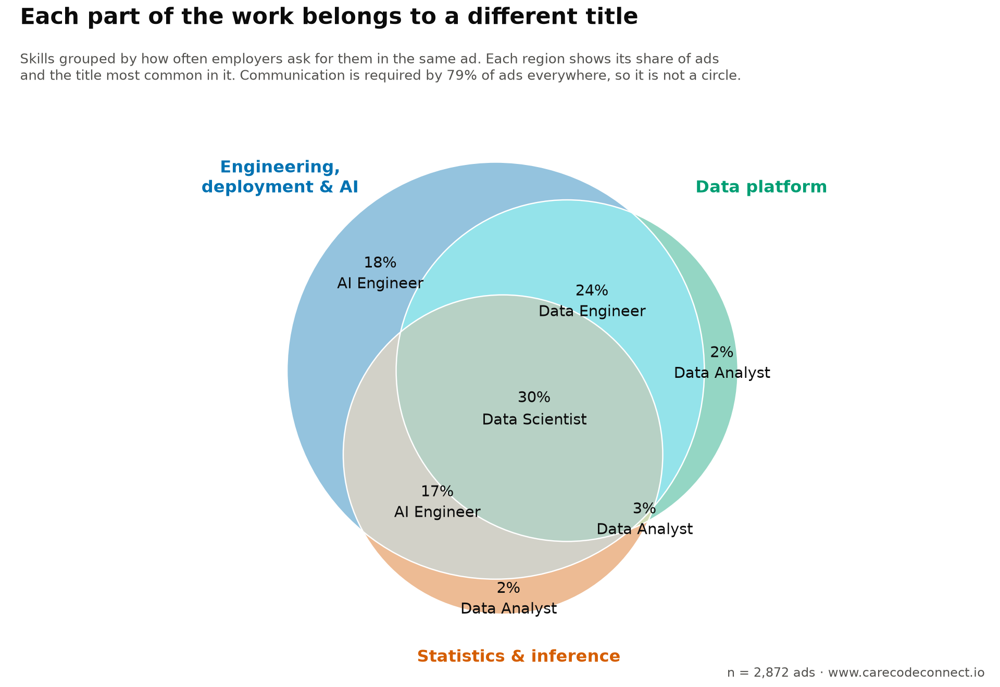
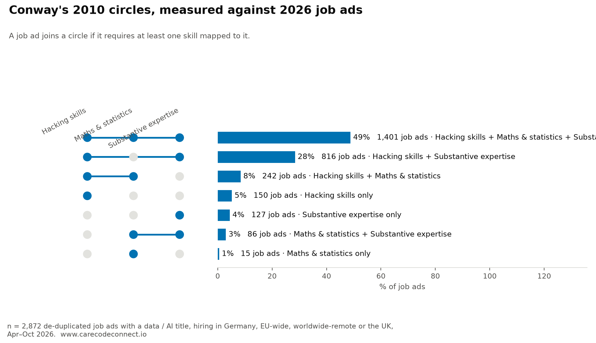
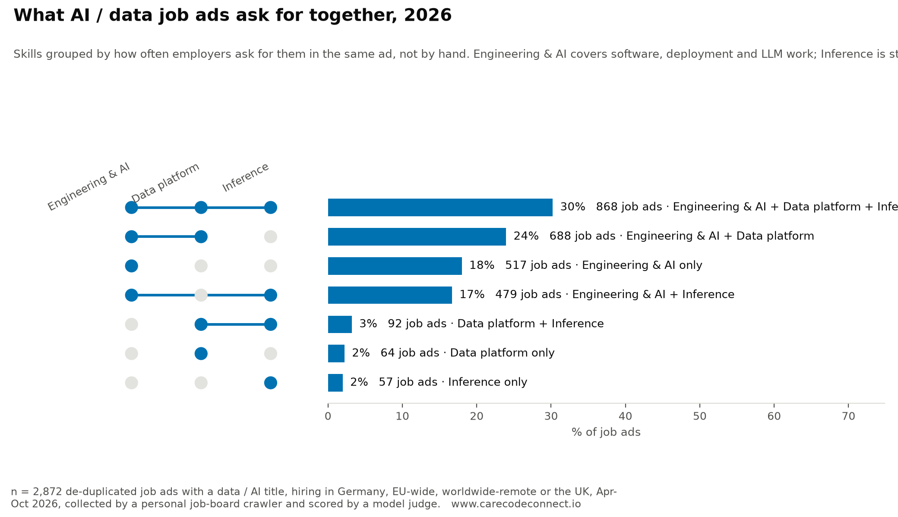
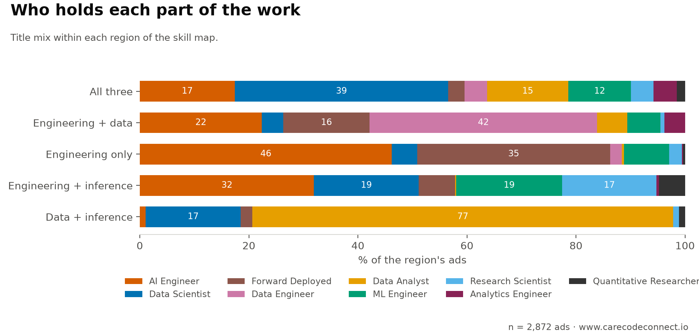

## Executive summary

**AI and data work has spread beyond the Data Scientist title.**  job ads for  data and AI titles, hiring in Germany, EU-wide, worldwide-remote or the UK, . A model judge read each in full and answered the same  questions of every one — does this ad require this skill.

{fig-alt="Venn diagram of three skill groups found by clustering the job ads, each region labelled with its share of ads and the job title most common in it"}

| | Answer |
|---|---|
| **RQ1** · Do Conway's 2010 circles still fit? | **No.** % of ads sit in his "danger zone"; % need a skill none of his circles covers; % need deployment, which none of them contains. |
| **RQ2** · Which skills are asked for together? | **Three groups.** Engineering, deployment & AI (% of ads), data platform (%), statistics & inference (%) — plus communication at %, required everywhere. |
| **RQ3** · How do the titles divide that work? | **One title per region.** The centre is % of ads and % of it is *not* Data Scientist. "AI Engineer" is the most advertised title at %. |

Three results behind those answers: a Data Scientist ad asks for the model **and** for running it (% need both); stakeholder communication is the most-required skill at %, ahead of Python at %; statistics is what separates the two headline titles, % against %.

## RQ1 · The 2010 circles no longer fit

Conway's 2010 diagram put data science where hacking skills, maths and statistics, and substantive expertise meet. Sized by how many of these ads land in each region:

{fig-alt="Conway's three circles redrawn with region areas proportional to the share of job ads in each"}

% of ads want code and domain engagement but no statistics — the region he marked "danger zone" and thought nearly empty.  tracked skills fit none of his circles at all, and % of ads require at least one.

**What is missing from his picture is deployment.** His three circles are knowledge — code, maths, domain. % of ads require a production skill, and model serving alone appears in % of Data Scientist ads, more than any single modelling skill.

::: {.callout-note collapse="true" appearance="simple"}
## The field's own definitions, and how they were tested {.unnumbered}

Three pictures the field has used. Only Conway's can be tested against a job ad: it says what a data scientist must *know*, and knowledge is what ads ask for. The other two describe a process, and no ad says "must be able to scrub".

](images/external/conway-data-science-vd.png){fig-alt="Drew Conway's data science Venn diagram"}

 (archived)](images/osemn.png){fig-alt="The OSEMN pipeline: obtain, scrub, explore, model, interpret"}

](images/external/r4ds-data-science-cycle.png){fig-alt="The R for Data Science cycle"}

An ad joins a circle if it requires at least one skill mapped to it. Only the measured figures and the 2026 circles are this page's own.
:::

## RQ2 · Three groups of skills, and one asked for everywhere

The  skills were clustered by how often employers ask for them *in the same ad*. Four groups fall out — three that divide the market, one required almost everywhere.

{fig-alt="Venn diagram of three skill groups with the share of ads in each region"}

- **Engineering, deployment & AI** —  skills, % of ads. Shipping software and building on LLMs fall in one group.
- **Data platform** —  skills, %.
- **Statistics & inference** —  skills, %. Classical ML, deep learning and computer vision cluster here, not with LLM work.
- **Communication** —  skills, %, in every region. The ground, not a circle.

::: {.callout-note collapse="true" appearance="simple"}
## What is in each group, and the demand ranking {.unnumbered}

Most required in each: engineering, deployment & AI — . Data platform — . Statistics & inference — . Communication — .

{fig-alt="Bar chart of every tracked skill by the share of ads requiring them"}

 leads at %, then  (%) and  (%). The tail is the specialist end: .
:::

## RQ3 · Each region belongs to a different title

{fig-alt="Stacked bars showing the job-title mix within each region of the skill map"}

The centre — ads needing all three groups — is % of the market, and % of it carries a title other than Data Scientist. Data-platform work belongs to Data Engineers, engineering without inference to AI Engineers, data-and-inference without engineering to Data Analysts (% of that region).

**A Data Scientist ad asks for the model and for running it.** % require both modelling and deployment, and of those requiring modelling, % require deployment too. The ad wanting a model but not its deployment is %.

{fig-alt="Stacked bars per job title showing the share of ads requiring both a model and its deployment, a model only, deployment only, or neither"}

**Statistics separates the two headline titles**: % of Data Scientist ads against % of AI Engineer ads. On full requirement profiles they are  apart — further than Data Scientist is from Data Analyst () — with ML Engineer the shortest link between them ( and ).

::: {.callout-note collapse="true" appearance="simple"}
## The titles by distance, the shared core, and the map {.unnumbered}

Each title's profile is the share of its ads requiring each skill; an edge is the [Euclidean distance](https://en.wikipedia.org/wiki/Euclidean_distance) between two profiles.



Data Engineer and Analytics Engineer are the closest pair at , reaching the rest of the market only through Data Analyst. Data Scientist, AI Engineer and ML Engineer share  required skills —  — and beyond those, Data Scientist and AI Engineer have nothing in common.

{fig-alt="Venn diagram of the core skills of Data Scientist, AI Engineer and ML Engineer ads"}

Where AI Engineer comes from: its nearest neighbour is ML Engineer (), and Data Engineer is  away — further than Data Scientist. One skill crosses the divide: model evaluation is required in % of AI Engineer ads and % of Data Scientist ads, against % of Data Engineer ads. Within the  engineering ads, evals run at % overall but % where A/B experimentation is also required (odds ratio , p ). LLM observability shows no such link (odds ratio , p ).

Each dot is one ad, placed by the  skills it requires ([t-SNE](https://www.jmlr.org/papers/v9/vandermaaten08a.html): nearby dots have similar requirements, and distances across the map carry no scale). Click a title in the legend to hide it.

<iframe src="cluster.html" title="Interactive skills map" width="100%" height="620" style="border:0;" loading="lazy"></iframe>
:::

::: {.callout-note collapse="true" appearance="simple"}
## Each of the  titles, one at a time {.unnumbered}


:::

## What it adds up to

The work has not been renamed; it has been divided. Three skill groups,  titles, and one title dominant in each region of the map. The centre still exists at % of ads, but most of it is not called Data Scientist.

Three limits. These are ads, not jobs: they record what employers asked for, not what the work became. The window is , so this shows how the work is divided now, not when any of it moved. The scores are model judgements, never checked against human labels, with agreement on the required call at [Cohen's κ](https://en.wikipedia.org/wiki/Cohen%27s_kappa) ≈ .

## How this was measured

::: {.callout-note collapse="true" appearance="simple"}
## Which ads, and where they came from {.unnumbered}

- ** job ads**, de-duplicated, with a data / AI title: AI Engineer , Data Scientist , Data Engineer , Forward Deployed , Data Analyst , ML Engineer , Research Scientist , Analytics Engineer , Quantitative Researcher .
- **Where they hire:** Germany, EU-wide remote, worldwide remote, or the UK. Live .
- **Where they come from:** employers' own boards and careers pages, aggregators, and a curated feed. The published data carries no source or employer, and the same opening reached by two routes counts once (matched on URL and on company + title).
- **Titles come from the ad**, by regular expression over the job title; "AI Engineer" includes variants such as "Senior Software Engineer – AI".
- **Not a random sample.** These are the ads a personal crawler targets, so they describe what the titles ask for, not how many of each exist.
:::

::: {.callout-note collapse="true" appearance="simple"}
## How the skills were scored {.unnumbered}

Scores come from the production pipeline of **jobcrawler**, a personal job-board crawler that scrapes employer ATS boards, filters by title and location with deterministic rules, and stores each ad. After storage every ad is read once by **[Jev](https://typesafe.ai)** ([TypeSafe](https://typesafe.ai)'s [System One](https://typesafe.ai/blog/introducing-system-one-models-and-jev) model, version ), which answers typed questions and returns probabilities rather than text.

- For each of ** tracked skills** Jev answers one four-level question: does the ad *not involve* the skill, *mention it in passing*, list it as *nice to have*, or *require* it. One question per skill, so an answer cannot contradict itself, and the same question is answered for every ad — which is the only reason the percentages compare across titles.
- An ad requires the skill when "required" reaches probability . Most judgements come back "not involved"; roughly one in six reaches "required".
- Jev has no part in choosing the ads: the pool is gathered and filtered by rules.
- Cost: about 6k input tokens per ad, under a cent.

The scores are model judgements, consistent across titles but never checked against human labels: read the percentages as what a careful reader of the ad would conclude, with a few points of noise. **"Required" is a high bar** — every percentage counts ads where the skill reaches *required*, not ads that mention it. Across all ads, Jev reads machine learning as mentioned in % and the second pass by [](https://www.anthropic.com/claude/haiku) names it in %, against % requiring it. Agreement on the required call is moderate ([Cohen's κ](https://en.wikipedia.org/wiki/Cohen%27s_kappa) ≈ ), so treat a single figure as approximate and the direction as solid.
:::

::: {.callout-note collapse="true" appearance="simple"}
## Where the skill list comes from, and how it grows {.unnumbered}

The  skills are a *fixed vocabulary*, not everything an ad might mention. A free-for-all count of whatever words appear cannot compare titles, because no two employers use the same words.

The list is curated but not frozen, and **two passes read every ad**. Pass one is Jev, above. Pass two is an open-vocabulary extraction: a small, cheap model ([](https://www.anthropic.com/claude/haiku)) reads each ad with one instruction — list every skill, tool or method it asks for, **in the ad's own words**, say whether it is required or nice to have, and quote the sentence showing it. Nothing is matched against the vocabulary at this stage; the model does not know it exists.

That covers the whole pool: ** mentions** across ** distinct phrases**,  of them in ten ads or more. An alias table maps a phrase onto a vocabulary skill where the mapping is obvious — "PostgreSQL" to SQL, "Kubernetes" to containers, "RLHF" to deep learning — and % of mentions map. **The rest are the point**: what ads keep asking for that the vocabulary has no question for, ranked by how many jobs require it.

A weekly review reads that ranking and proposes additions; a human accepts or rejects, because adding a skill re-scores every ad. The review of  accepted four — **software engineering** ( jobs), **data governance** (), **APIs and integration** () and **responsible AI** () — and rejected three: "problem-solving" ( jobs) and English and German ( between them) are traits and languages rather than skills, and "data science" () is the name of the field.

Adding "software engineering" overturned one of this page's own findings: before it was tracked, Data Scientist and AI Engineer appeared to share no core skill at all. Every figure regenerates whenever the vocabulary moves (vocabulary as of ).
:::

::: {.callout-warning collapse="true" appearance="simple"}
## One known limitation: is machine learning simply assumed? {.unnumbered}

Partly. Of  Data Scientist ads,  never write machine learning, deep learning or neural network — but % of those name a technique or tool that unmistakably is one. Correcting for that raises the figure from % to about %, meeting the independent estimate from the other direction (% detected at some level).

The remaining  ads (% of Data Scientist ads) name neither the concept nor any of its tools, asking instead for Python, SQL, A/B testing, causal inference, R, dbt, Tableau and stakeholder communication.
:::

::: {.callout-note collapse="true" appearance="simple"}
## The data, the charts, and permissions {.unnumbered}

The underlying data is published with this page: [**download it here**](data/ai-data-job-skills.csv), with a [**companion list of the skills**](data/skills.json) and their areas. One row per ad — title, title family, hiring region, month, position on the map, and a yes/no flag for each of the  skills. Deliberately absent: employer names, links, and any ad text. Enough to redraw every chart and check any number, without republishing anyone's postings.

Charts use [plotnine](https://plotnine.org) for the static figures and [Plotly](https://plotly.com/python/), styled to match, for the interactive map. Colours come from the [Okabe-Ito colour-blind-safe palette](https://jfly.uni-koeln.de/color/), and wherever more than three categories share a plot, marker shape carries identity as well as colour.

Conway's diagram is reproduced with attribution from [drewconway.com](http://drewconway.com/zia/2013/3/26/the-data-science-venn-diagram) (Drew Conway, *The Data Science Venn Diagram*, 2010). Only the measured figures and the 2026 circles are this page's own.
:::

