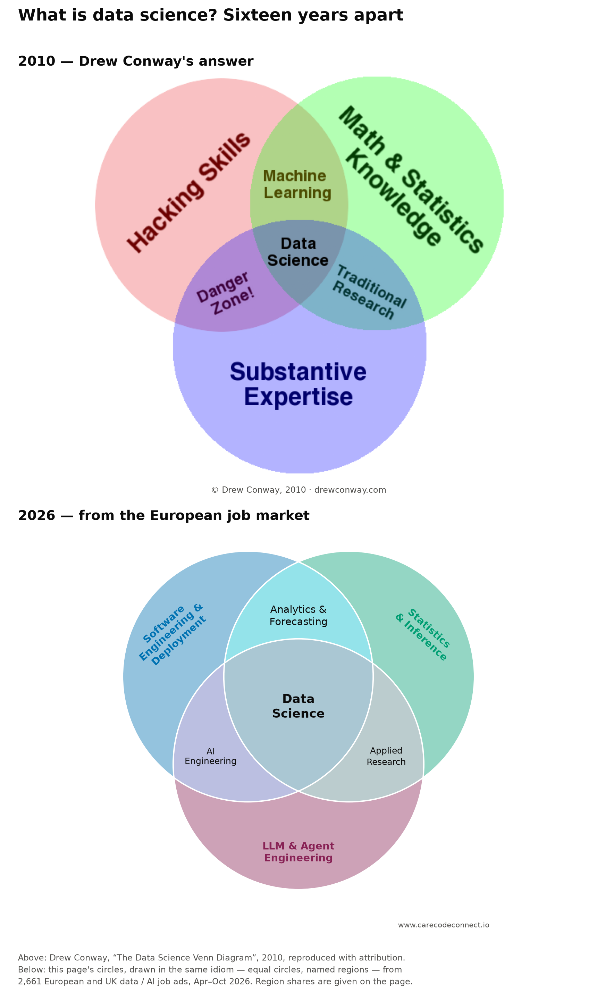
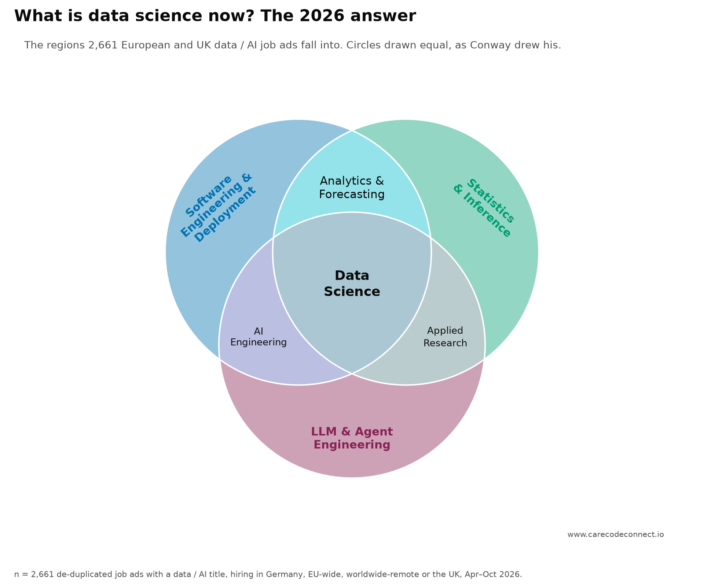

{fig-alt="Two data science Venn diagrams, one above the other: Drew Conway's 2010 version with hacking skills, maths and statistics and substantive expertise, and below it a 2026 version measured from job ads with software engineering and deployment, statistics and inference, and LLM and agent engineering"}

## Executive summary

In October 2012 *Harvard Business Review* called data scientist [the sexiest job of the 21st century](https://hbr.org/2012/10/data-scientist-the-sexiest-job-of-the-21st-century). Under the heading "A New Breed", Thomas Davenport and D.J. Patil defined the new role as a senior professional with "the training and curiosity to make discoveries in the world of big data", and described the person as a hybrid of hacker, analyst, communicator and trusted adviser — a combination they called rare. Fourteen years on, that is the job this page goes looking for in what European employers actually advertise.

**What does a data scientist do now?** The evidence here is what employers ask for rather than what practitioners say they do, which is a narrower question but a checkable one.

**The short answer.** Drew Conway's 2010 Venn — hacking skills, maths and statistics, substantive expertise, data science in the middle — no longer describes what European employers advertise. His "danger zone" of code without statistics is now % of ads rather than a rare corner, and % of ads require at least one skill his framework has no circle for at all: LLM applications, agents, RAG, evaluation. Data science has not been renamed; it has split into a chain of adjacent jobs, and "Data Scientist" now sits further from "AI Engineer" than it does from "Data Analyst".

**What this is.** Every job ad a personal crawler collected for data and AI roles hiring in Germany, EU-wide remote, worldwide remote or the UK —  de-duplicated ads, . Each one was read in full by a model judge and scored against a fixed vocabulary of  skills in  areas, one question per skill, so the same question is answered for every ad and the numbers are comparable across job titles. The question behind it: is "AI Engineer" the new name for "Data Scientist", or a different job?

**What we learnt.**

1. **The classic definition has stopped describing the market.** Measured against Conway's three circles, half of all ads (%) still land in the centre, but % land in the "danger zone" he thought nearly empty, and % require GenAI skills none of his circles covers.
2. **They are different jobs, and the data says how.** "Data Scientist" and "AI Engineer" are  apart on their requirement profiles — further than Data Scientist is from Data Analyst (). The dividing skill is statistics: required in % of Data Scientist ads and % of AI Engineer ads.
3. **The market has three branches, not two.** An engineering branch specialising *into* AI, an inference branch of quants and analysts, and a third branch that builds the data itself. "ML Engineer" is the only short step between the first two ( from Data Scientist,  from AI Engineer), which makes it the cheapest title to move to from either side.
4. **A title that looks isolated may just be missing its neighbour.** "Data Engineer" appeared to be an outlier until "Analytics Engineer" was tracked as its own title this week. They are now the closest pair on the whole map (), and data governance — required in % of Analytics Engineer ads and % of Data Engineer ads, against % elsewhere — is what marks that branch out.
5. **The shared core is professional, not technical.** Data Scientist, AI Engineer and ML Engineer ads share exactly  core skills: . Beyond those five they have nothing in common at all.
6. **Communication outranks every technical skill.** It is required in % of all ads, ahead of Python at %. And % of "AI Engineer" ads do not require Python at all — many are TypeScript, platform or vendor-integration roles wearing the title.

Hover the map further down to see what any single job ad asked for.

::: {.callout-note collapse="true" appearance="simple"}
## Population and sample {.unnumbered}

- ** job ads**, de-duplicated, with a data / AI title: AI Engineer , Data Scientist , Data Engineer , Forward Deployed , Data Analyst , ML Engineer , Research Scientist , Analytics Engineer , Quantitative Researcher .
- **Where they hire:** Germany, EU-wide remote, worldwide remote, or the UK. Live .
- **Where they come from:** a mix of employers' own job boards and careers pages, aggregators, and a curated feed — the published data deliberately carries no source or employer, so that split is not in the CSV; the same opening reached by two routes counts once (matched on URL and on company + title).
- **Not a random sample of the market.** It is the ads a personal crawler targets, so it describes what these titles ask for, not how many of each exist.
:::

## Which titles are hiring: the sample by job title

{fig-alt="Bar chart of the nine job-title families as a share of the ads"}

**Upshot:** "AI Engineer" is the most frequent title, close to one ad in four (). "Data Scientist" is second at %, "Data Engineer" third at %. "Analytics Engineer" (%) and "Quantitative Researcher" (%) are the rarest — small, but each distinct enough in what it asks for to be worth separating, which the distance diagram further down shows. Titles come from the ad itself (a regular expression over the job title); "AI Engineer" includes variants such as "Senior Software Engineer – AI". This chart says *what* is being hired, not *who* is hiring. Each of the nine gets its own section later on, in the approximate order the titles appeared: see [Nine job titles, one at a time](#nine-job-titles-one-at-a-time).

## What is data science now?

The canonical answer is sixteen years old. In September 2010 **Drew Conway** drew three overlapping circles — hacking skills, maths and statistics, substantive expertise — and put data science in the middle. Where code met domain knowledge without statistics he wrote **"danger zone!"**: people who can pull data and run a regression without understanding what the coefficients mean.

::: {.callout-note collapse="true" appearance="simple"}
## Sources and permissions for the figures in this section {.unnumbered}

Conway's diagram is reproduced with attribution from [drewconway.com](http://drewconway.com/zia/2013/3/26/the-data-science-venn-diagram) (Drew Conway, *The Data Science Venn Diagram*, 2010); the *R for Data Science* cycle under its [CC BY-NC-ND 3.0](https://creativecommons.org/licenses/by-nc-nd/3.0/us/) licence. The 2012 *Harvard Business Review* article is [Davenport and Patil, *Data Scientist: The Sexiest Job of the 21st Century*](https://hbr.org/2012/10/data-scientist-the-sexiest-job-of-the-21st-century), quoted briefly with attribution. The pipeline models have their own sources: [Mason and Wiggins, 2010](https://web.archive.org/web/20160220042455/dataists.com/2010/09/a-taxonomy-of-data-science/) (archived; also as a [PDF](https://introdatasci.dlilab.com/pdf/A_Taxonomy_of_Data_Science.pdf)) · [Janssens, *Data Science at the Command Line*](https://datascienceatthecommandline.com/2e/chapter-1-introduction) · [Wickham, Çetinkaya-Rundel and Grolemund, *R for Data Science*](https://r4ds.hadley.nz/). Only the measured figures and the 2026 circles are this page's own.
:::

### The three canonical answers

Conway's is one of three pictures the field has used to define itself, and the other two are not Venns at all. One says what a data scientist must **know**; the other two say what a data scientist **does**.

**1. Conway, 2010 — what you must *know*.** Three circles of knowledge, data science in the middle. The only one of the three that can be tested against a job ad, and the one the rest of this section measures.

](images/external/conway-data-science-vd.png){fig-alt="Drew Conway's data science Venn diagram: hacking skills, math and statistics knowledge, substantive expertise, with machine learning, danger zone, traditional research and data science in the overlaps"}

**2. Mason & Wiggins, 2010 — what you *do*, as five steps.** Published the same month as Conway, and a description of a process rather than a person. They call it the Snice taxonomy and coin the acronym **OSEMN** in the same post.

 (archived) · [PDF](https://introdatasci.dlilab.com/pdf/A_Taxonomy_of_Data_Science.pdf)](images/osemn.png){fig-alt="The OSEMN pipeline: obtain, scrub, explore, model, interpret"}

**3. Wickham et al. — what you *do*, as a loop.** The *R for Data Science* cycle: import and tidy once, then loop through transform, visualise and model, then communicate, with programming underneath all of it.

](images/external/r4ds-data-science-cycle.png){fig-alt="The R for Data Science cycle: import, tidy, then a loop of transform, visualise and model, then communicate, with program surrounding all of it"}

[Jeroen Janssens](https://datascienceatthecommandline.com/2e/chapter-1-introduction) adopts Mason and Wiggins's steps wholesale as the spine of *Data Science at the Command Line*. Their line on the least glamorous one has outlasted the rest — scrubbing data is "the least sexy part of the analysis process".

Only Conway's can be tested against a job ad. The other two describe what you *do*, and employers advertise for knowledge and experience, not for steps in a process — no ad says "must be able to scrub". So it is Conway's that the rest of this section measures.

### The same circles, measured

Conway drew his freehand; the regions never carried numbers. Here they are sized by how many of ** European and UK job ads** land in each — an ad joins a circle if it requires at least one skill mapped to it.

{fig-alt="Conway's three circles redrawn with region areas proportional to the share of job ads in each"}

**The danger zone is not a corner. It is a quarter of the market.** % of ads ask for code and domain engagement but require no statistics at all. Conway thought this region nearly empty, reasoning that nobody picks up programming and domain knowledge without absorbing some statistics on the way. It is now the second-largest region, behind only the centre (%) and bigger than his "machine learning" (%) and "traditional research" (%) lenses combined.

**And a whole limb of the job has no circle at all.**  of the tracked skills — LLM applications, agents, RAG, evaluation, fine-tuning, observability, responsible AI — fit none of the three. They are not hacking, not statistics, not domain knowledge. **% of all ads require at least one**, rising to % of AI Engineer ads, and the share is flat across every month in the sample. A 2010 framework cannot see what half the market is asking for.

### Our answer: the 2026 circles

So here is the diagram redrawn with circles chosen to fit what the ads actually cluster into, rather than what the field believed about itself in 2010. It is drawn in Conway's idiom on purpose — equal circles, named regions, no numbers on the diagram — because his works by being readable in two seconds. The shares are given below it, and the proportional version of the same data is the figure above.

{fig-alt="A 2026 data science Venn diagram with three equal circles — software engineering and deployment, statistics and inference, LLM and agent engineering — with the overlaps named data science, analytics and forecasting, AI engineering and applied research"}

**Two of these are Conway's circles under new names, and one is genuinely new — that distinction matters.**

*Software engineering & deployment* is his **hacking skills**, and the rename is not cosmetic. Conway meant the ability to manipulate data with code. The ads mean building systems *and running them*: model serving alone is required in % of all ads, the third most-demanded skill of the . It is the largest circle, at % of ads.

Shipping is not a separate trade from building, which is worth stating because job titles often imply it is. % of ads require both, only % want building without deployment, and just % want deployment without building. There is no meaningful population of people who only deploy.

*Statistics & inference* **is Conway's maths and statistics circle** — the name is different, the content very nearly is not, and it is the one circle of his three that survives intact. Two changes, both small: deep learning and NLP have left it for the LLM circle, because in 2010 neural methods were a branch of statistics and in 2026 they are advertised as a branch of engineering; and product analytics and BI have joined it, because the ads treat drawing a defensible conclusion from a dashboard as the same job as drawing one from a model. What is left is what Conway meant: knowing whether a number means anything. It is required by % of ads. If this circle looks unchanged, that is the finding — the statistics have not moved. Everything around them has.

The two real changes are at the edges. **LLM and agent engineering is new**, covering % of ads, and it is the limb Conway's diagram has no room for. And **substantive expertise stops being a circle at all**: stakeholder communication appears in % of ads, far too universal to divide anyone, so it has become the ground the three circles stand on rather than one of them. Conway's third circle has not shrunk so much as dissolved into the floor.

The grammar is Conway's: **data science stays in the centre** — all three circles at once — and the two-way lenses are named sub-practices, as his "machine learning", "traditional research" and "danger zone" were. The lens names here come from what is most distinctive in each region rather than from intuition.

### What happened to machine learning?

Conway named one of his overlaps **machine learning**, so its absence from the 2026 diagram is the first thing to explain. Two preliminaries. Machine learning was never a *circle* in his diagram either — his three circles are hacking, maths and domain, and "machine learning" is the name he gave to one overlap between them. And machine learning has not been dropped from ours: classical ML sits inside *statistics & inference*, deep learning inside *LLM & agent engineering*. No skill is named on either diagram; both name regions.

**The distinction that matters is building a model versus calling one.** Training a model and using one over an API are different jobs, and the vocabulary blurs them because both get called “AI work”. Separated out: % of ads require building or training a model (classical ML, deep learning, fine-tuning, computer vision, recommenders) and % require calling one (LLM applications, retrieval, agents, observability). Only % require both. The asymmetry is the finding: % of ads want the API work with **no** model-building at all, against % that build without ever touching an API. Fine-tuning — the one skill that sits between the two — is required in just %.

By title the split is sharp. ML Engineer (% build) and Research Scientist (%) still train models; Data Scientist is %. The AI Engineer inverts it — % call an API and only % build — and the Analytics Engineer is the clean case: % build anything, while % are expected to call a model. A job can now require AI without requiring machine learning.

**The bigger shift is what displaced it.** Machine learning of any kind is required in % of ads (classical ML %, deep learning %). The LLM stack — LLM applications, agents, RAG, fine-tuning, observability — is required in %. More pointedly, % of ads want the LLM stack and require **no** machine learning at all, against % that want machine learning and no LLM work. Using a model has come apart from training one, and the larger half of the market is the using — which is why the new circle on the diagram is *LLM & agent engineering* rather than *machine learning*.

**It cannot be a circle, because it does not divide anything.** Drawn generously — classical ML, deep learning, computer vision and recommender systems together — machine learning is required in % of ads (), against % for the smallest circle on the diagram. More decisively, % of those ads already fall inside one of the three circles and % fall in the dead centre of all three. An ML circle would enclose a region of its own containing  ads out of . It is a layer running through the three circles — covering % of the engineering circle, % of inference and % of the LLM circle — not a fourth dimension.

**And Conway's label no longer fits his own region.** Of the ads that land in his code-and-maths-without-domain corner, % actually require machine learning — against % of the ads in his centre. The region his diagram calls "machine learning" is no more machine-learning-heavy than the middle of the picture. That is why the name is gone: not because the skill vanished, but because it stopped marking out that part of the map.

::: {.callout-warning collapse="true" appearance="simple"}
## Caveat: is machine learning simply assumed in a data science ad? {.unnumbered}

A fair objection. An employer advertising for a Data Scientist may not write "machine learning" because it goes without saying, and a method that reads ads would then under-count it. This was tested rather than waved away, and the objection is **partly right**.

Of the  Data Scientist ads,  never use the words machine learning, deep learning or neural network. Of those silent ads, % (≈) do name a technique or tool that is unmistakably machine learning — predictive modelling, regression analysis, classification, clustering, feature engineering, scikit-learn, PyTorch, gradient boosting. For those, the skill really is implied rather than stated, and counting only the literal phrase understates it.

Correcting for that raises the Data Scientist figure from % to about % — which lands on the independent estimate from the other direction, since the scoring model detects machine learning at some level in % of the same ads. Three readings converge.

The remaining  ads (% of all Data Scientist ads) name neither the concept nor any of its tools or methods. What they ask for instead is Python, SQL, A/B testing, causal inference, R, dbt, Tableau and stakeholder communication — an experimentation and analytics profile, not a modelling one. So the floor is real: **about a third of Data Scientist ads are not machine-learning jobs in any reading**. The honest version of the headline is that machine learning is required in a minority of ads and present in roughly a third, and that the gap between those two numbers is exactly the "assumed, not stated" effect.
:::

**The danger zone, by contrast, did not disappear — it was promoted and given a job title.** Conway's danger zone was building things without the statistics to know whether they work, and that is our **AI engineering** region: engineering and LLM work with no inference requirement, now % of ads, the largest lens on the diagram, with % of its ads titled AI Engineer. The warning label became a career.

Where machine learning *is* required, it has moved toward engineering rather than dispersing: % of ML ads require model serving, against % of everything else. What is left is a specialism of particular titles rather than a region: classical ML is a Data Scientist skill (% of those ads), deep learning a Research Scientist and ML Engineer one (% and %), while the AI Engineer — the biggest family in the sample — barely touches either (% and %) and % of those ads want the LLM stack instead. The AI Engineer does not do machine learning in Conway's sense.

Read that way: data science is % of ads under Conway's circles but **%** under ours, which is the honest figure for the full thing today. The largest lens is **AI engineering** at %, discussed above. **Analytics & forecasting** is %: engineering and inference without LLM work, distinguished by quant research, BI, forecasting and time series, and mostly titled Data Scientist or Data Analyst. **Applied research** is the smallest at %, inference and LLM work without the engineering, split between Data Scientist and Research Scientist.

**So, against the other roles:** data science is no longer one circle in the middle of three. It is a chain of adjacent jobs, mapped in the sections below, with "Data Scientist" at the inference end and "AI Engineer" at the LLM end — and the two are further apart than Data Scientist is from Data Analyst. There is no single centre left to stand in.

## Role specialisation, not a rebrand

The question behind this page is whether "AI Engineer" is the new name for "Data Scientist", or a different job. The ads say different job, and they say how. Scored on what each ad *requires*, the  titles arrange themselves into three branches:

- **The engineering branch** — AI Engineer, ML Engineer, Forward Deployed, Research Scientist. What makes these ads alike is LLM applications, agents, NLP, model serving, evals, CI/CD. Statistics is required in % of AI Engineer ads. (Research Scientist sits nearest ML Engineer, : evals, deep learning, research.)
- **The inference branch** — Quantitative Researcher, Data Scientist, Data Analyst. Statistics, experimentation, forecasting, SQL, BI. Quant ads are the extreme case: % require statistics, % forecasting.
- **The data branch** — Data Engineer and Analytics Engineer, far from everything else: pipelines (% and % of their ads), warehouse, dbt, cloud, and almost no statistics (% and %), ML or GenAI. These two are the closest pair on the whole map (), which is the clearest result of adding "Analytics Engineer" as its own title: it is not a flavour of Data Analyst ( away) but the analyst-facing end of data engineering — SQL in % of its ads, dbt in %. The branch reaches the rest of the market only through Data Analyst ( from Analytics Engineer,  from Data Engineer).

Everything below is the evidence: who is hiring for what, which skills are in demand, how far apart the titles are, and the map of all  ads.

## The  skills, ranked by demand

::: {.callout-note collapse="true" appearance="simple"}
## Where the number comes from {.unnumbered}

These are not every skill a job ad might mention — they are a *fixed vocabulary* the model judge is asked about, one question per skill, so that the same question is answered for every ad and the percentages below are comparable across titles. A free-for-all count of whatever words appear in an ad cannot do that, because no two employers use the same words.

The list is curated but not frozen: it currently holds  skills across  areas, and it grows when the evidence says it should. A second pass reads every ad and records the skills it names *in the ad's own words*; when a phrase keeps coming up with no home in the vocabulary, it becomes a skill or a synonym of one. Four skills were added this week that way. [How that works](#the-skill-list-is-not-fixed-by-hand) is at the foot of the page.
:::

{fig-alt="Bar chart of every tracked skill by the share of ads requiring them"}

**Upshot:** the one skill most ads require is not technical: , %.  (%) and  (%) follow, then  (%),  (%),  (%) and  (%). The bottom of the list is the specialist tail: .

## The titles, by distance between what they require

Each title's profile is the share of its ads requiring each of the  skills; the number on an edge is the distance between two profiles (Euclidean over all  shares), so a smaller number means more alike. Beside it: the skills that most separate the pair. The inference branch is on the left, the engineering branch on the right; "ML Engineer" is the hinge.



Blue nodes are the inference branch, orange the engineering branch, purple the data branch; "ML Engineer" (solid blue) is the hinge. Solid edges trace the chain from one end of the market to the other; dashed edges mark the nearest neighbour of a side title.

**Upshot:** the market is a chain, not a cluster. From one end to the other: Quantitative Researcher → Data Scientist → ML Engineer → AI Engineer, with every step between  and  while the direct Data Scientist to AI Engineer distance is . "ML Engineer" is the only short step across the divide ( from Data Scientist,  from AI Engineer).

Adding "Analytics Engineer" this week changed the shape of the left-hand side. "Data Engineer" used to look like an outlier whose least-distant neighbour was Data Analyst. It is not an outlier at all — it has a close partner, and that partner is Analytics Engineer at **, the shortest distance on the whole map**. The two form a data branch that touches the rest of the market only through Data Analyst. The lesson is general: a title that looks isolated may simply be missing its neighbour from the taxonomy.

## Shared core, separate specialisms

{fig-alt="Venn diagram of the core skills of Data Scientist, AI Engineer and ML Engineer ads"}

{fig-alt="Scatter plot of every tracked skill: share of Data Scientist ads requiring each skill against share of AI Engineer ads"}

**Upshot:** the three titles share a -skill core, and it is a professional one rather than a specialism: . Beyond those five, Data Scientist and AI Engineer ads have *nothing* in common. Statistics, SQL, classical ML, A/B experimentation, forecasting and product analytics belong to Data Scientist alone; LLM applications, agents, NLP, RAG, APIs and responsible AI to AI Engineer alone. ML Engineer shares the same five and adds MLOps tooling, containers and deep learning.

This is a change from the previous version of this page, and worth saying plainly. Before "software engineering" was tracked as a skill, Data Scientist and AI Engineer appeared to share *no* core skill whatsoever. They do share one, and it is a big one: software engineering is required in % of AI Engineer ads and % of Data Scientist ads. The earlier finding was an artefact of the vocabulary, not of the market — which is the risk any fixed taxonomy carries, and the reason for the second pass described at the foot of the page.

**Reading the Venn.** Each region is "required by these titles and *not* the others", so the Data Scientist / AI Engineer lens is empty: everything those two share, ML Engineer requires as well, which puts all  in the centre. That is the finding, not a gap — the hinge title has no core skill of its own that the other two lack. A "core skill" is one required in at least % of a title's ads; the circles are drawn equal, so only the lists carry information. The scatter is the same data without the threshold: each dot is a skill, and the sparse top-left and bottom-right corners are what "diverge beyond the core" looks like. Every skill is labelled; the cluster of rarely required skills in the bottom-left corner is where the niches live.

## The skills map

Each dot is one job ad, placed by the  skills its description requires (t-SNE: nearby dots have similar requirements; distances across the map carry no scale). Click a title in the legend to hide it; use the drop-down to see where a skill area concentrates. The engineering branch fills the right-hand side, the inference branch the top and left; Quantitative Researcher ads sit at the far statistics end.

<iframe src="cluster.html" title="Interactive skills map" width="100%" height="760" style="border:0;" loading="lazy"></iframe>

**Upshot:** the titles form islands, not a continuum. Data Analyst and Data Engineer are separate islands on the left; AI Engineer fills the right; Forward Deployed is its own corner at the bottom (customer-facing, few technical requirements). ML Engineer is the one title scattered across both halves.

## What a "Data Scientist" job asks for vs an "AI Engineer" job

{fig-alt="Dumbbell chart of ten skill areas: share of Data Scientist vs AI Engineer jobs requiring at least one skill in each area"}

**Reading it:** each row is one skill area, and the two dots are the share of each title's ads requiring at least one skill in it. **The length of the bar between them is the disagreement** — a long bar means the two titles want very different things there, a short bar means they want much the same. The label names whichever title asks more often, and by how many percentage points. The rows are ordered by the Data Scientist share, not by the gap, so the longest bars are easy to spot but are not at the top.

Statistics & experimentation is the big split (% of Data Scientist ads vs % of AI Engineer ads). GenAI / LLM engineering is the mirror image (% vs %). Machine learning itself is nearly even (% vs %). % of "AI Engineer" ads do not require Python at all: many are TypeScript, platform or vendor-integration roles wearing the title.

## Nine job titles, one at a time



## Job tips from the data

- **Compete where the pile is small.** "AI Engineer" is the largest pile of ads (%) and the loosest: % do not require Python, so applicants from every software background compete for them. The skills with few ads are also the ones with few qualified applicants: causal inference is required in % of Data Scientist ads and % of AI Engineer ads; forecasting % vs %; time series % vs %. If that is your expertise, the niche is where your CV is rare.
- **Statistics is a moat, not a legacy skill.** It is required in % of Data Scientist ads, % of Quantitative Researcher ads, % of Data Analyst ads, and % of AI Engineer ads — and % of Data Engineer and % of Analytics Engineer ads. Position on the inference branch and it is your strongest card; position on the engineering branch and it barely registers.
- **The hinge title is the cheapest move.** A data scientist who adds MLOps tooling, model serving and containers becomes an "ML Engineer" candidate (distance ); a software engineer who adds LLM applications, agents and NLP becomes an "AI Engineer" candidate (). Jumping straight from Data Scientist to AI Engineer is the long step (). The same logic runs the other way: an Analytics Engineer is  from Data Engineer, the cheapest title move on the map.
- **Evals are where an inference background actually transfers — LLMOps is not.** Among the  AI Engineer and ML Engineer ads, % require model evaluation. That rises to % in the ads that also require A/B experimentation and % in those requiring statistics — the experimentation link is strong and highly significant (odds ratio 4.2), the statistics link real but modest (1.7). LLM observability behaves differently: it travels with evals (× more likely) but has **no** association with statistics at all (odds ratio 0.8, not significant). So the evidence says a statistician's habits buy you the *evaluation* half of AI engineering, not the *operations* half. A caution on reading this: across all  ads, statistics and evals look completely unrelated — the association only appears once you compare like with like inside the engineering titles, because Data Scientists supply the statistics and AI Engineers supply the evals.
- **Communication is the universal requirement.** % of all ads, % of Data Scientist ads and % of Data Analyst ads. It is the one thing on this list that no title lets you skip.

## Method

::: {.callout-note collapse="true" appearance="simple"}
## How the skills were scored {.unnumbered}

The requirement scores come from the production pipeline of **jobcrawler**, a personal job-board crawler that scrapes employer ATS boards, filters by title and location with deterministic rules, and stores each ad. After storage every ad is read once by **Jev** (TypeSafe's System One model, version ), which answers typed questions over the ad and returns probabilities rather than text.

- For each of ** tracked skills** (Python, SQL, RAG, agents, statistics, A/B experimentation, model serving, LLM observability, …) Jev is asked one four-level question: does the ad *not involve* the skill, *mention it in passing*, list it as *nice to have*, or *require* it. One question per skill, so an answer cannot contradict itself.
- An ad counts as requiring the skill when the "required" level reaches a probability of 0.6. Most skill-by-ad judgements come back "not involved" — any one ad asks for a small slice of the vocabulary — and roughly one in six reaches "required".
- The same request asks Jev for the role family, seniority, whether professional German is required, and whether the employer could hire someone living in Berlin; the crawler's dashboard and daily digest use those answers.
- Jev has no part in choosing the ads: the pool is gathered and filtered by rules, and the job-title families on the map come from regular expressions over the title. "Data Scientist" vs "AI Engineer" is literally what the employer called the job.
- Cost: about 6k input tokens per ad, under a cent, so the whole sample was scored for a few dollars.

The scores are model judgements, consistent across titles but never checked against human labels: treat the percentages as what a careful reader of the ad would conclude, with a few points of noise.

**"Required" is a high bar, and the machine-learning numbers show why it matters.** Every percentage on this page counts ads where the skill reaches *required*, not ads that mention it. For Data Scientist ads and machine learning the two readings differ a lot: Jev scores classical ML or deep learning as *required* in %, as required-or-nice-to-have in %, and detects it at any level in %. The second model agrees without being asked to — reading in the ad's own words with no knowledge of the vocabulary, Haiku names machine learning, deep learning or neural networks in % of the same ads and calls it required in %. Across all judged ads the two converge closely on mentions: % by Jev, % by Haiku, against % that reach *required*. So a Data Scientist ad is likelier to name machine learning than to require it — but on the loosest measure either model offers, **a third to a half of Data Scientist ads do not ask for machine learning at all**, which is the claim the page actually rests on. Agreement on the required call is moderate rather than strong (Cohen's κ ≈  on those ads) and the two models disagree in both directions, so treat the individual figure as approximate and the direction as solid.
:::

::: {.callout-note collapse="true" appearance="simple"}
## How the skill list grows, and who decides {.unnumbered}

There are **two passes over every ad**, and they do different jobs.

**Pass one — Jev, the scorer.** The fixed vocabulary above. Same questions, every ad, probabilities out. This is what every percentage on this page is built from, and the only reason those percentages can be compared across job titles at all.

**Pass two — an open-vocabulary extraction.** Every stored ad is also read by a small, cheap model (Claude Haiku), five ads to a call, with one instruction: list every skill, tool or method this ad asks for, **in the ad's own words**, and for each one say whether it is required or merely nice to have, and quote the sentence that shows it. Nothing is matched against the vocabulary at this stage — the model does not know the vocabulary exists. The output is stored one row per mention, with its evidence quote, keyed to a hash of the ad text so an unchanged ad is never re-read.

That has now covered the whole pool: ** skill mentions** across ** distinct phrases**, of which  appear in ten ads or more. A deterministic alias table then maps each phrase onto a vocabulary skill where the mapping is obvious — "PostgreSQL" to SQL, "Kubernetes" to containers, "RLHF" to deep learning. % of all mentions map. **The rest are the point**: those are the things ads keep asking for that the vocabulary has no question for, and they are ranked by how many jobs require them.

A weekly review reads that ranking and proposes additions, which a human accepts or rejects — the vocabulary is never edited automatically, because adding a skill re-scores every ad in the pool. The review of  accepted four on that evidence: **software engineering** (named in  jobs), **data governance** (), **APIs and integration** () and **responsible AI** (). Phrases like Git, PostgreSQL, Excel and model monitoring became synonyms of skills already present. Three frequent phrases were deliberately *rejected*: "problem-solving" ( jobs) and English and German ( between them) are traits and languages rather than skills, and "data science" () is the name of the field.

So the two passes check each other. The fixed list makes the numbers comparable; the open pass is the evidence for changing the fixed list. Adding "software engineering" this week overturned one of this page's own findings, which is exactly what the second pass is for. Every figure here regenerates from the same scripts whenever the vocabulary moves (vocabulary as of ).
:::

## Data

The underlying data is published alongside this page: [**download it here**](data/ai-data-job-skills.csv), with a [**companion list of the skills**](data/skills.json) and their areas.

It holds one row per job ad — the title, which title family it falls into, the hiring region, the month, its position on the map, and a yes/no flag for each of the  skills. Deliberately not included: employer names, links, or any of the ad text. That is enough to redraw every chart here and check any number in it, without republishing anyone's job postings.

::: {.callout-note collapse="true" appearance="simple"}
## How the charts were drawn {.unnumbered}

Charts are drawn with [plotnine](https://plotnine.org) for the static figures and [Plotly](https://plotly.com/python/), styled to match, for the interactive map. Colours come from the Okabe-Ito colour-blind-safe palette, and wherever more than three categories share a plot, marker shape carries the identity as well as the colour, because no set of nine colours is reliably distinguishable.
:::
